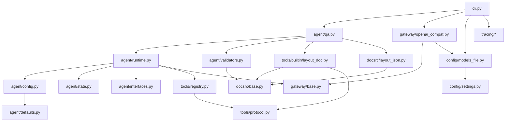
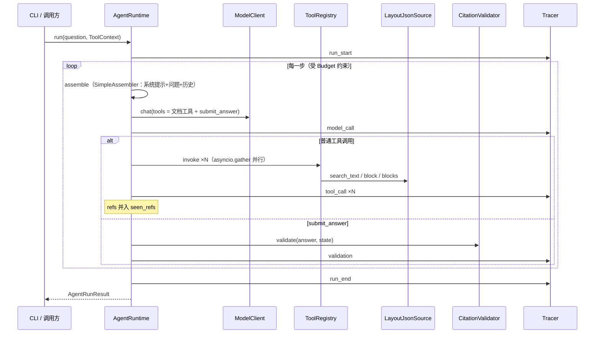
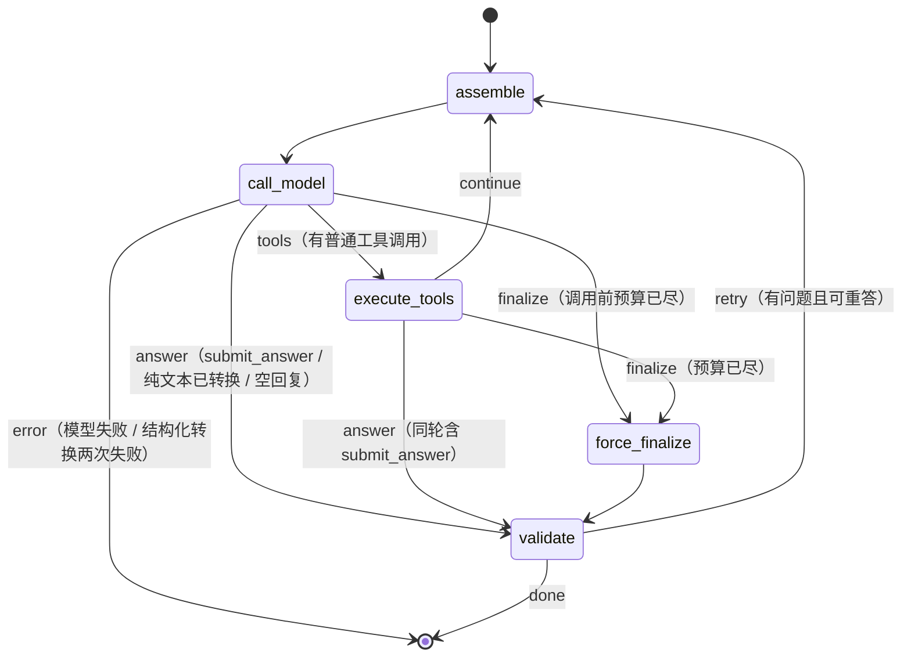

# P1 代码地图（Codemap）

> 范围：P1 最小 Agent Loop（v0.1.0）。接口的冻结定义见 `docs/interfaces/agent-runtime.md`，变更记录见 `CHANGELOG.md`。

## 1. 一句话

用户问题 → `AgentRuntime`（LangGraph ReAct 循环）→ 模型通过 `OpenAICompatClient` 调用 → 模型选择文档工具（`grep` / `get_block` / `list_blocks`）读取 `layout.json` → 通过 `submit_answer` 提交带块 ID 引用的结构化答案 → `CitationValidator` 校验 → 返回 `AgentRunResult`，全程由 `Tracer` 记录。

## 2. 目录

```text
drugpaper/
├── cli.py                        # typer 入口：drugpaper ask
├── config/
│   ├── settings.py               # Settings / get_settings()：.env 与环境变量
│   └── models_file.py            # models.yaml 解析 → ResolvedModel
├── gateway/
│   ├── base.py                   # ModelClient 协议、消息/请求/响应模型、异常
│   └── openai_compat.py          # OpenAICompatClient（P1 唯一实现）
├── tools/
│   ├── protocol.py               # ToolSpec / Tool / ToolContext / ToolResult / @tool
│   ├── registry.py               # ToolRegistry.invoke：错误转结果、超时、截断
│   └── builtin/layout_doc.py     # list_blocks / get_block / grep
├── docsrc/
│   ├── base.py                   # DocumentSource 协议、BlockView、Hit
│   ├── layout_json.py            # LayoutJsonSource
│   └── textnorm.py               # strip_latex / compact_key：仅用于匹配（P2 由 IR 的 text_norm 取代）
├── agent/
│   ├── state.py                  # Budget、AgentState、AgentAnswer、Citation、AgentRunResult
│   ├── interfaces.py             # 扩展点协议
│   ├── defaults.py               # StaticToolset、SimpleAssembler、NoopValidator
│   ├── config.py                 # AgentConfig
│   ├── runtime.py                # AgentRuntime（核心）
│   ├── validators.py             # CitationValidator
│   ├── qa.py                     # 文档问答 Agent 的装配 build_qa_agent()
│   └── prompts/qa_system.md      # 问答系统提示
└── tracing/
    ├── jsonl.py                  # JsonlTracer、CompositeTracer、NullTracer、summarize
    └── console.py                # ConsolePrinter
config/models.yaml                # 模型注册表（最小子集）
tests/
├── conftest.py                   # --smoke 开关、fixtures 路径
├── fakes/fake_llm.py             # FakeLLM、ListTracer、call/tools/submit/text
├── fakes/mock_http.py            # MockChatServer（httpx2.MockTransport）
├── fixtures/jmedchem_2c00949/    # 真实样例论文的 MinerU 产物
├── fixtures/mini_layout/         # 合成 layout.json
├── unit/                         # 单元测试（不访问外部服务）
└── smoke/test_live_model.py      # 真实端点冒烟（默认跳过）
scripts/verify_phase_1.py         # 阶段验收脚本
docs/interfaces/agent-runtime.md  # 冻结接口
samples/outputs/phase-1/          # 验收问答输出
```

## 3. 模块依赖

箭头表示"导入"。`agent` 只依赖协议（`gateway/base`、`tools/protocol`、`docsrc/base`），不依赖具体实现；具体实现只在装配层（`qa.py`、`cli.py`）出现。



## 4. 一次问答的执行过程



## 5. AgentRuntime 状态机（`agent/runtime.py`）



节点与关键方法：

| 节点 | 方法 | 做什么 | 写入的状态字段 |
|---|---|---|---|
| assemble | `_assemble` | `ContextAssembler.build(state)` | `prompt` |
| call_model | `_call_model` | 预算检查；绑定 `toolset.tools_for()` + `submit_answer`；解析响应；纯文本时追加 1 次结构化转换 | `steps`、`model_calls`、`usage`、`messages`、`pending_calls`、`submission`、`route` |
| execute_tools | `_execute_tools` | 超出 `max_tool_calls` 的调用直接返回错误；其余并行 `registry.invoke(allowed=当前工具集)`；结果转 `role=tool` 消息 | `messages`、`seen_refs`、`tool_calls`、`route`、`budget_exhausted` |
| force_finalize | `_force_finalize` | 追加"预算已用尽"提示，只绑定 `submit_answer` 调用 1 次；未作答时生成兜底答案 | `submission`、`warnings`、`stop_reason` |
| validate | `_validate` | 解析 `submission` → `answer_model`；运行 validators；可重答则反馈，否则 sanitize 并写警告 | `final`、`stop_reason`、`warnings`、`validation_retries`、`route` |

辅助方法：`_chat`（统一计数、usage 累加、`model_call` 事件）、`_invoke_tool`（`tool_call` 事件）、`_fallback_answer`、`_error_update`、`_merge_warnings`、`_to_result`。

`submission.source` 的取值：`tool`（模型调用 submit_answer）、`text`（纯文本经结构化转换）、`forced`（force_finalize 中作答）、`fallback`（运行时兜底）、`empty`（模型空回复）。

`stop_reason` 的判定：预算用尽过 → `budget_exhausted`；否则校验通过 → `answered`；重答后仍有问题 → `validation_failed`；模型错误 → `error`。

## 6. 模块速查

### config

| 符号 | 说明 |
|---|---|
| `Settings` | `env`（`DRUGPAPER_ENV`）、`database_url`、`redis_url`、`runs_dir`（`./runs`）、`models_config_path`（`config/models.yaml`） |
| `load_models_file(path)` | YAML → `ModelsFile`（宽松模型，P7 可扩字段）；格式错误抛 `ModelsConfigError` |
| `resolve_task(file, task, env)` | task → stage → model/pool[0] → provider，只展开用到的变量；缺失抛 `MissingEnvVarError(var, where)` |
| `load_default_model(settings, task="default")` | 环境变量来源：`.env` 在下、进程环境在上 |

### gateway

| 符号 | 说明 |
|---|---|
| `OpenAICompatClient(model, max_attempts=3, retry_base_delay_s=1, retry_jitter_s=0.3, http_client=None)` | 一个实例对应一个端点 |
| `build_kwargs(req, mode)` | 请求转换，可直接用于断言 |
| `build_responses_kwargs` / `_request_responses` | `api: responses` 请求、SSE 结果聚合、工具调用续接；`response_items` 保存原生结果和加密思考上下文供后续调用与 checkpoint 重放 |
| `_chat_once` / `_request_with_retry` | 降级（`_structured_mode_cache`）与 tenacity 重试 |
| `parse_structured(content, schema)` | 去 `<think>`、去代码围栏、截取 JSON 对象后校验；失败抛 `SchemaViolation` |
| `_map_error` | openai / httpx2 异常 → 类型化异常 |

2026-10-01 真实联调补充：文本 Agent 使用 `gpt-6-luna`、Responses API、`reasoning.effort=medium`。可复现命令与判定依据见 `docs/dev-plan/real-acceptance-p1-p2.md`；`scripts/verify_live_p1_p2.py` 使用独立验收库。旧版本离线完成记录不代替真实服务验收。

### tools / docsrc

| 符号 | 说明 |
|---|---|
| `@tool(name, description, ...)` | 从 `async (ctx, args: Model)` 生成 `FunctionTool`；返回值可以是 `ToolResult`、Pydantic 模型或 dict |
| `ToolSpec.to_schema()` | `compact_json_schema` 去掉字符串值的 `title` |
| `ToolRegistry.invoke(ctx, call, allowed=...)` | 六步：不存在 → 非法 JSON → 参数校验 → 超时 → 异常 → 截断 |
| `truncate_result(result, max_chars)` | `data={"truncated_text": ...}`，refs 只保留可见部分 |
| `LayoutJsonSource.from_file(path)` | `document_id` = 文件名去掉 `_layout` |
| `LayoutJsonSource.search_text` | 先匹配原文，不命中再匹配 `strip_latex(text)`（懒计算缓存） |
| `strip_latex` / `compact_key` | 去 LaTeX 命令与上下标花括号；compact 再去空白、连字符并小写。`quote_matches`（validators）用它容忍 MinerU 文本瑕疵 |
| `make_layout_tools(source)` | 返回 3 个工具；`LAYOUT_TOOL_NAMES` |

### agent / tracing

| 符号 | 说明 |
|---|---|
| `Budget.exhausted_reason(state)` | 返回用尽原因字符串或 None |
| `state_messages(state)` / `seen_ref_set(state)` | 从状态还原 `Message` 列表 / 引用集合 |
| `CitationValidator(source).validate / sanitize` | 三条规则；sanitize 只保留有效引用 |
| `build_qa_agent(layout, model, tracer, budget=None)` | 返回 `QaAgent`，`await agent.ask(question)` |
| `JsonlTracer(runs_dir).path_for(run_id)` | 每行：`ts`、`run_id`、`trace_id`、`parent_run_id`、`kind` + 摘要负载 |
| `ConsolePrinter` | `--verbose` 时与 JsonlTracer 组合输出 |

## 7. 常见改动怎么做

| 需求 | 改哪里 |
|---|---|
| 换模型地址 / 模型名 | `.env` 的 `LLM_BASE_URL` / `LLM_MODEL`；或 `config/models.yaml` 的 `providers.*.base_url`、`models.*.model_name` |
| 端点不支持 `json_schema` | 自动降级；也可在 models.yaml 设 `capabilities.structured_output: json_object` |
| 关闭 Qwen 思考开关注入 | models.yaml `capabilities.thinking.toggle: none` |
| 新增一个工具 | 定义 Pydantic 输入模型 + `@tool` 装饰的 async 函数 → `registry.register()` → 把名字加入 `StaticToolset` |
| 新增一个校验器 | 实现 `validate(answer, state) -> list[str]`（可选 `sanitize`）→ 加入 `AgentConfig.validators` |
| 换一种答案结构 | 自定义 Pydantic 模型 → `AgentConfig.answer_model`；`submit_answer` 的参数 Schema 自动跟随 |
| 做一个新 Agent | 新建 `AgentConfig`（提示、工具集、校验器、预算、task）+ 复用 `AgentRuntime`，参考 `agent/qa.py` |
| 调整预算 | `Budget(...)` 或 CLI 的 `--max-steps` 等参数 |

## 8. 后续阶段的替换点

| 替换点 | 现在 | 替换为 | 调用方是否需要改 |
|---|---|---|---|
| `DocumentSource` | `LayoutJsonSource` | P2 IR + 数据库（块 ID 不变） | 否 |
| `grep` | 在 `text` / `caption_text` 上正则匹配 | P2 基于规范化文本的完整实现 | 否 |
| `Tracer` | `JsonlTracer` | P2 RunRecord 入库 | 否 |
| checkpointer | `InMemorySaver` | P2 Postgres（`AgentRuntime(checkpointer=...)`） | 否 |
| `ToolsetProvider` | `StaticToolset` | P3 `DisclosureToolset` | 否 |
| `ContextAssembler` | `SimpleAssembler` | P3 `PromptAssembler` | 否 |
| `ModelClient` | `OpenAICompatClient`（忽略 task） | P3 按任务路由；P7 `ModelGateway` | 否 |

## 9. 测试地图

| 测试文件 | 覆盖 |
|---|---|
| `tests/unit/test_settings.py` | 配置加载、缺失变量、YAML/字段错误、引用断链 |
| `tests/unit/test_gateway_base.py` | 消息模型序列化往返、Usage 累加、异常属性 |
| `tests/unit/test_openai_compat.py` | 正常文本、工具调用、非法参数 JSON、500×2 后成功、5xx 耗尽、429 重试、4xx 不重试、超时、json_schema、降级与缓存、Schema 修复成功 / 两次失败、图片与工具消息转换 |
| `tests/unit/test_tools.py` | 注册重名、未知工具、白名单、参数错误、非法 JSON、超时、异常、截断、Schema 生成 |
| `tests/unit/test_layout_doc.py` | 合成数据：块 ID、合并组、空块、bbox 归一化、正则/字面量检索、3 个工具 |
| `tests/unit/test_real_paper.py` | 真实论文：17 页 / 块 ID 唯一且合法 / bbox 合法、合并组与 F3 现象、S1.5 三项验证、LaTeX 回退检索、quote 容错与拒绝、FakeLLM 端到端问答 |
| `tests/unit/test_textnorm.py` | `strip_latex`、`compact_key` |
| `tests/unit/test_validators.py` | 有效引用、未见过的引用、quote 不匹配、无引用、sanitize |
| `tests/unit/test_runtime.py` | 执行方案 S1.11 表中全部 9 个用例，加上：max_steps=1、兜底答案、max_model_calls、max_tool_calls、耗时预算、同轮 submit+工具、submit 参数不合 Schema、模型错误、截断结果、JSONL 还原执行过程、并发 run 隔离 |
| `tests/unit/test_tracing.py` | 摘要截断、保留字段、ConsolePrinter 输出 |
| `tests/unit/test_cli.py` | `--help`、`--json` 输出、`-v` 输出、配置错误退出码 |
| `tests/smoke/test_live_model.py` | 真实端点："你好"、两个验收问题（答案含 26 / D1、≥1 个有效引用、≤5 步） |

## 10. 命令

```bash
uv sync                                     # 安装依赖
uv run pytest tests/unit -q                 # 单元测试（= make test）
uv run ruff check drugpaper tests scripts && uv run mypy   # lint（= make lint）
uv run pytest tests/smoke -q --smoke        # 冒烟（需要 .env）
uv run python scripts/verify_phase_1.py [--smoke]          # 阶段验收（= make verify-p1）
uv run drugpaper ask <layout.json> "问题" -v              # 手动问答，追踪写入 runs/<run_id>.jsonl
```
