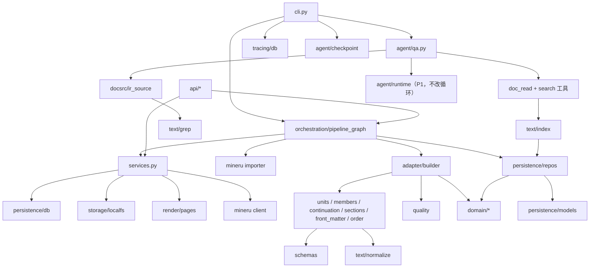
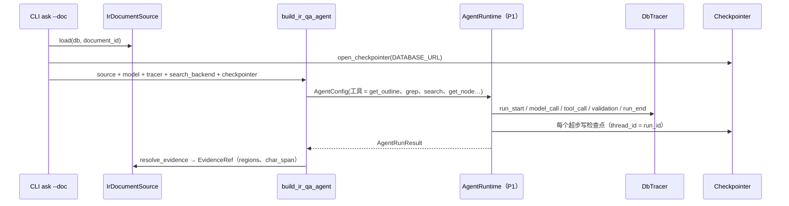

# P2 代码地图（Codemap）：文档底座

> 范围：v0.2.0。P1 的循环与扩展点见 `phase-1-codemap.md`；冻结接口见 `docs/interfaces/document-ir.md`、`openapi-p2.json`；变更记录见 `CHANGELOG.md`。

2026-10-01 真实联调：新增 `scripts/verify_live_p1_p2.py`，覆盖真实 MinerU 提交、独立 PostgreSQL 迁移 / 原生检索 / 跨进程恢复、真实模型问答和 API；验收范围与人工抽查缺口见 `docs/dev-plan/real-acceptance-p1-p2.md`。Agent 文本模型为 GPT-6 Luna（中等思考）；正文首次出现与含摘要的全文首次出现分别验收。

## 1. 一句话

PDF（或已有的 MinerU `auto/` 目录）→ **管线**（ingest → mineru_parse → build_ir → render_and_index）→ 原始产物进 **BlobStore**、**IR** 进数据库 → **API** 提供树、节点、页面图、裁剪图、检索 → **P1 的 AgentRuntime** 换上 `IrDocumentSource` 与 IR 工具包即可问答，引用落到页面区域；运行记录进 `runs` 表，PostgreSQL 上可从检查点恢复。

## 2. 新增目录

```text
drugpaper/
├── domain/                       # 领域模型（无 IO）
│   ├── ids.py                    # ULID、doc_ID、节点局部 ID、全局引用 {doc}/r{rev}/{local}
│   ├── geometry.py               # BBox / Region / Geometry 与坐标换算
│   └── nodes.py                  # DocumentNode、Relation、EvidenceRef、QualityReport、DocumentMeta、IRDocument
├── parsers/mineru_legacy/
│   ├── schemas.py                # layout.json / middle.json 宽松模型
│   ├── client.py                 # MinerU 服务客户端（提交/轮询/拉取，背压，429 退避）
│   ├── paths.py                  # 路径穿越过滤、资产分类
│   ├── importer.py               # 离线导入 auto/ 目录、产物转存与 parse_revision
│   ├── line_enricher.py          # layout ↔ middle 块对齐、行几何
│   ├── quality.py                # 质检、大框包含小框
│   ├── snapshot.py               # IR 快照（回归测试）
│   └── adapter/                  # IR Builder（按 7.3 节顺序）
│       ├── context.py            # BuildContext：节点表、排序键、空块登记、问题列表
│       ├── units.py              # 1-2 单元识别（原始块 / 页内组 / 跨页组 / 解散文本组）
│       ├── node_types.py         # 3 标签正则、类型判定、脚注标记解析
│       ├── members.py            # 4 成员：图注 / 脚注 / 图内部件 / 被吞正文
│       ├── continuation.py       # 5 续段与行级增强（F5/F6）
│       ├── sections.py           # 6 章节树、section_role、句首小标题
│       ├── front_matter.py       # 7 标题、作者、Cite This、DOI
│       ├── order.py              # 8 阅读顺序
│       └── builder.py            # build_ir()：串起全部步骤 + 9 质检 + text_norm
├── text/
│   ├── normalize.py              # text_norm 与 raw↔norm 偏移（Normalized.map_span）
│   ├── latex_rules.yaml          # LaTeX 符号 / 格式命令 / 转义规则
│   ├── vocab.py                  # 词频表（wordninja）：连字符合并、粘连词拆分
│   ├── grep.py                   # GrepEngine（7.9.3 节）
│   └── index.py                  # InMemorySearch / PostgresSearch（fts、trgm、hybrid）
├── persistence/
│   ├── models.py                 # SQLAlchemy 表
│   ├── db.py                     # Database：异步引擎与会话（PG / SQLite）
│   ├── migrate.py                # 编程方式运行 Alembic
│   ├── migrations/versions/      # 0001_core、0002_text_index
│   └── repos/documents.py, nodes.py
├── storage/base.py, localfs.py, assets.py   # BlobStore 协议、本地实现、资产登记
├── render/pages.py               # 页面渲染、裁剪、PDF 信息（PyMuPDF）
├── docsrc/ir_source.py           # IrDocumentSource（实现 P1 的 DocumentSource）
├── tools/builtin/doc_read.py     # get_outline / get_node / get_children / get_context_window / get_section / get_page_text
├── tools/builtin/search.py       # grep / search
├── tracing/db.py                 # DbTracer → runs 表
├── agent/checkpoint.py           # Postgres checkpointer（schema lg）/ 内存
├── orchestration/pipeline_graph.py  # DocumentPipeline（LangGraph）
├── services.py                   # Services：db、store、renderer、mineru 的装配
└── api/                          # FastAPI：app / deps / errors / schemas / documents / nodes / search / blobs
alembic.ini
tests/unit/ir/                    # IR Builder 分步测试 + 快照
tests/integration/                # PostgreSQL 集成测试（pgserver / TEST_DATABASE_URL）
scripts/verify_phase_2.py
```

P1 模块的变化：`agent/qa.py`（新增 `build_ir_qa_agent`、`resolve_evidence`）、`agent/runtime.py`（新增 `resume`）、`agent/state.py`（`AgentRunResult.evidence`）、`docsrc/textnorm.py`（委托 `text/normalize.py`）、`cli.py`（新命令）、`config/settings.py`（新配置项）。

## 3. 模块依赖



`domain/` 不依赖任何 IO 模块；IR Builder 只依赖 `domain/`、`schemas`、`text/normalize`，可以离线单测。

## 4. 管线（`orchestration/pipeline_graph.py`）

```mermaid
flowchart LR
    S([run]) --> put[PDF 入 BlobStore<br/>sha256 去重：已 ready 直接返回]
    put --> A[ingest<br/>建文档 / 登记 pdf 资产<br/>status=parsing]
    A --> B[mineru_parse<br/>在线：MinerUClient.parse<br/>离线：read_output_dir<br/>store_result → parse_revision<br/>status=parsed]
    B --> C[build_ir<br/>inspect_pdf → build_ir<br/>image_path → image_blob<br/>save_ir（PG 更新 tsv）<br/>status=ir_built]
    C --> D[render_and_index<br/>逐页渲染 page_image 资产<br/>status=ready]
    D --> E([PipelineResult])
    A & B & C & D -. 异常 .-> F[status=failed<br/>error={code, stage, message}]
```

状态只存引用；每个节点由 `_wrap` 统一计时与失败落库。

## 5. IR Builder 数据流（`adapter/builder.py::build_ir`）

| 步骤 | 函数 | 输入 → 输出 | 关键规则 |
|---|---|---|---|
| 1 解析 | `schemas.load_layout / load_middle` | JSON → 宽松模型 | 未知字段 → `source_ref.extra` |
| 2 单元 | `units.identify_units` | 页 → `Unit(kind, anchor, members, order)` | 成员 = `merged_from ∪ belong_to`；文本组解散；跨页组 `x…` |
| 3-4 节点 | `members.build_units` | Unit → 节点 | 标签正则、F2 类型、F3 `caption_mismatch`、F4 被吞正文、脚注标记、空块登记 |
| 5 续段 | `continuation.resolve_continuations` | 空块 + middle 行 → continuation region | 行中心落在空块 → 认领；`cross_page` 行看后两页；否则推导 `derived` |
| 兼容 | `quality.filter_contained_visuals` | 视觉节点 | 大框包含小框 > 0.8 → `figure_part` |
| F9 | `builder._discarded` | middle `discarded_blocks` | `p{page}.d{k}`，不在主树 |
| 6 章节 | `sections.build_sections` | 顶层节点 → `doc` / `front` / `s000…` | 全大写 = 章节；句首小标题 `.h0`；role 下传 |
| 7 前置 | `front_matter.extract_front_matter` | front 子节点 → `DocumentMeta` | Cite This 正则；DOI 文本 → 文件名 |
| 8 顺序 | `order.assign_reading_order` | 树 → `reading_order` | 先序遍历，子节点按排序键 |
| 9 质检 | `quality.run_checks` | 全部节点 → `QualityReport` | 越界、重叠、资产、页数、扫描页 |

排序键 = `page × 10000 + 在 para_blocks 中的位置`（与 confirmed_index 一致；成员紧随组；被吞正文排在组前）。

## 6. 文本规范化（`text/normalize.py`）

`_Buffer` 同时维护文本和每个字符对应的原文区间；每条规则用 `sub(pattern, repl)` 改写，`repl` 返回"保留第 i 个字符"或"插入字面量"。规则顺序：NFKC → 控制字符 → 转义 → 符号命令 → 格式命令 → 未知命令 → 上下标与花括号（循环，公式内逐字符空格合并）→ `~` → 行尾连字符 → 各类破折号 → 缺空格（词+数字、数字+词、小写+大写词）→ 公式外逐字符数字 → `D1 R` → 空白压缩。

`Normalized.map_span(s, e)` 把 norm 区间映射回 raw 区间，grep 的 `char_span`、证据的 `char_span` 都由此得到。

## 7. Agent 接入



`drugpaper resume --doc <id> <run_id>` 调用 `AgentRuntime.resume`：读取最后一个检查点，重置耗时预算后继续执行。

## 8. 模块速查

| 符号 | 说明 |
|---|---|
| `build_ir(layout, middle, *, document_id, revision, source_name, pdf_page_count, scanned_pages, available_assets, pdf_page_sizes)` | IR 构建入口 |
| `ir_snapshot(ir)` | 回归快照 |
| `Database(url).session(user_id)` | 会话（PG 设置 `app.current_user_id`）；`create_all()` 仅用于 SQLite |
| `upgrade(url) / downgrade(url)` | Alembic |
| `save_ir / load_ir / get_tree / get_node / children / nodes_on_page / context_window` | IR 仓储 |
| `create_document / set_status / create_revision` | 文档仓储 |
| `LocalFsBlobStore(root, user_id).put/get/exists/url` | 按内容寻址 |
| `store_result(session, store, doc_id, files, extra_pdf)` | 产物转存 |
| `MinerUClient(base_url, max_inflight, ...).parse(pdf, filename)` | 在线解析 |
| `PageRenderer(store, cache_dir).render_page / crop` | 渲染缓存 |
| `GrepEngine(nodes).grep(GrepQuery)` | grep |
| `InMemorySearch(nodes) / PostgresSearch(session, doc, rev)` | fts / trgm / hybrid |
| `IrDocumentSource(ir)` / `await IrDocumentSource.load(db, doc_id)` | IR 数据源 |
| `DbTracer(db, jsonl=None)` | 写 runs；`await aclose()` |
| `open_checkpointer(url)` | PG → AsyncPostgresSaver，否则内存 |
| `DocumentPipeline(services).run(pdf= / offline_dir=)` | 管线 |
| `create_app(services)` / `export_openapi(path)` | API |

## 9. 常见改动怎么做

| 需求 | 改哪里 |
|---|---|
| 新论文排版出现新的块类型 | `adapter/node_types.RAW_TYPE_MAP`；未知类型已保留为 `unknown` 节点并记问题 |
| 调整图注 / 脚注识别 | `node_types.LABEL_RE`、`FOOTNOTE_RE`；成员分类在 `members._build_visual` |
| 调整章节识别 / 新 role | `sections.SECTION_ROLES`、`is_section_heading`、`run_in_heading` |
| 新增 LaTeX 符号 | `text/latex_rules.yaml`，并提升 `NORM_VERSION`，重跑快照（`UPDATE_IR_SNAPSHOT=1`）并人工核对 |
| grep 覆盖新节点类型（P5 表格单元格） | `text/grep.SEARCHABLE_TYPES` |
| 新增 API | `drugpaper/api/` 新 router，在 `app.create_app` 中注册，重新导出 OpenAPI |
| 换对象存储（MinIO/S3） | 实现 `storage/base.BlobStore`，在 `Services.from_settings` 替换 |
| 换 PDF 渲染库 | 只改 `render/pages.py` |

## 10. 测试地图（P2 新增）

| 测试 | 覆盖 |
|---|---|
| `tests/unit/test_geometry.py` | 坐标换算、往返误差、IoU、ID |
| `tests/unit/test_normalize.py` | 规范化规则、化学名不被拆、偏移映射 |
| `tests/unit/ir/test_schemas.py` | 样例 layout / middle 解析 |
| `tests/unit/ir/test_units.py` | 标签正则、类型判定、成员识别、文本组解散、跨页组、未知类型 |
| `tests/unit/ir/test_members.py` | F1、F2、F3、F4、脚注标记、legacy_id |
| `tests/unit/ir/test_continuation.py` | F5/F6、跨页续段、图注混入正文、无 middle 推导、合成跨栏 |
| `tests/unit/ir/test_sections.py` | 章节与 role、句首小标题、前置信息、阅读顺序、F7、F9 |
| `tests/unit/ir/test_builder_snapshot.py` | 节点快照、质检、页面尺寸、包含关系 |
| `tests/unit/test_migrations_sqlite.py` / `test_repos.py` / `test_storage.py` | 迁移、仓储、BlobStore |
| `tests/unit/test_mineru_client.py` | 模拟服务：提交、轮询、429、超时、路径过滤、背压；离线导入 |
| `tests/unit/test_render.py` | 渲染、裁剪、坐标正确性（裁剪区内的 PDF 文字） |
| `tests/unit/test_grep.py` | grep 的 char_span、scope、截断、References 排除；检索三种模式 |
| `tests/unit/test_ir_agent.py` | IrDocumentSource、工具、Agent 在 IR 上问答、崩溃恢复 |
| `tests/unit/test_db_tracer.py` | runs 表的父子 Run |
| `tests/unit/test_pipeline.py` / `test_api.py` / `test_cli.py` | 管线、API 全链路、CLI |
| `tests/integration/test_postgres.py` | PG 迁移、IR + FTS/trgm、runs + checkpointer 跨进程恢复 |

## 11. 命令

```bash
uv run drugpaper db upgrade                                     # 迁移（未配置 DATABASE_URL 时为本地 SQLite）
uv run drugpaper ingest --offline tests/fixtures/jmedchem_2c00949   # 离线导入样例论文，输出 document_id
uv run drugpaper ask --doc <document_id> "文中 Table 3 的标题是什么？" -v
uv run drugpaper resume --doc <document_id> <run_id>            # PostgreSQL 上从检查点恢复
uv run drugpaper serve                                          # http://127.0.0.1:8000/docs
make test && make test-int && make verify-p2
```
