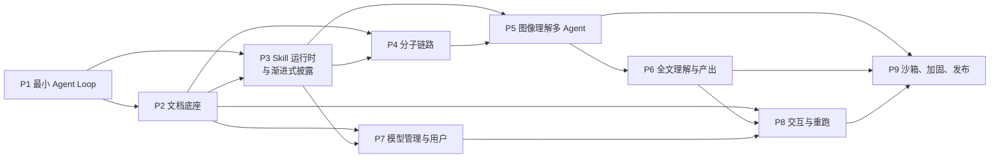

# 开发计划总览

2026-11-20 开发调试需求更新：本期前后端实现按[P8 第 10 节](phase-08-interaction-ui-rerun.md#10-本期开发调试需求基线2026-11-20)与[新增执行方案 S8.D0–D7](execution/phase-08-execution.md#2026-11-20-新增执行范围全过程开发调试待开发)推进；总体设计补充 13.7/17.6。覆盖合并布局、自动/手动模式、单图逐步调试、局部 Skill/工具代码版本、分子修正与上游复用重跑。新增项待开发，原阶段交付和准确率验收结论不变。

> 依据：`docs/drug-paper-agent-detailed-design.md`（v3.0，下称"设计文档"）
> 思路：从最小的 Agent Loop 起步，先让系统"能跑起来"，再一层层替换和充实。每个阶段结束时，系统都是可运行、可演示、可测试的。

---

## 1. 核心策略：接口先行，逐层替换

第一阶段就把后续所有阶段要用到的**扩展点**定义为接口，先放最简单的实现；后续阶段不改调用方，只替换实现。这样每一阶段新增的能力，都能立刻被已有的 Agent Loop 使用。

| 扩展点（接口） | P1 最简实现 | 被替换 / 充实的阶段 | 最终形态（设计文档章节） |
|---|---|---|---|
| `ModelClient` 模型调用 | 单端点 OpenAI 兼容客户端 | P3 按任务名调用；P7 网关（阶段、池、限流、熔断、计量、用户自定义模型） | 18.2 |
| `ToolsetProvider` 可用工具集 | 固定工具列表 | P3 CapabilityRouter + 元工具 + 动态激活 | 9.6 |
| `ContextAssembler` 上下文装配 | 拼接系统提示 + 历史 | P3 PromptAssembler（分层 prompt、能力预算） | 8.15、9.6.8 |
| `DocumentSource` 文档数据源 | 直接读 `layout.json` | P2 Document IR + 数据库 | 6、7.3 |
| `Tracer` 执行记录 | JSONL 文件 | P2 RunRecord 入库；P3 Artifact 与依赖 | 6.10、19.2 |
| `Checkpointer` 状态持久化 | 内存 | P2 Postgres checkpointer | 7.2 |
| `AnswerValidator` 结果校验 | 引用必须出现在工具结果中 | P5/P6 各层校验器 | 11 |
| `Budget` 预算 | 步数、调用数、时长 | P5 调用纪律计数（D38）；P9 负载降级 | 7.6、7.7.8 |

**一个 Agent Loop，多种 Agent**：P1 实现的通用循环 `AgentRuntime`，后续被以下 Agent 复用，差别只在配置（提示、工具集、输出 Schema、预算、钩子）：

```text
AgentRuntime（P1）
 ├── 文档问答 CLI（P1、P2 演示用）
 ├── FigureAgent 的补救决策（P5）
 ├── DocLookup 子 Agent（P6）
 ├── ReaderAgent（P6，读页调用不带工具，复用循环的预算、追踪、校验）
 └── 对话 Agent（P8）
```

---

## 2. 阶段划分

| 阶段 | 文件 | 目标（一句话） | 预计工作量 |
|---|---|---|---|
| P1 | `phase-01-minimal-agent-loop.md` | 最小可运行的 Agent Loop：模型调用 + 工具协议 + ReAct 循环 + 预算 + 追踪 + 引用校验 | 2 人 × 2 天 |
| P2 | `phase-02-document-foundation.md` | 文档底座：MinerU 接入、Document IR、数据库、存储、渲染、检索、最小 API | 2 人 × 4 天 |
| P3 | `phase-03-skill-runtime-and-disclosure.md` | Skill 协议与运行时、Artifact 体系、热加载、渐进式披露与动态工具集 | 1～2 人 × 4 天 |
| P4 | `phase-04-molecule-pipeline.md` | 分子链路：MolDet 服务、MolParser、标注图、E-SMILES、拼接、回填、化合物归一 | 1～2 人 × 5 天 |
| P5 | `phase-05-figure-agents.md` | 图像理解多 Agent：结构化 Skill、FigureAgent（三次调用 + 自检 + 补救）、Coordinator、批量管线 | 2 人 × 5 天 |
| P6 | `phase-06-full-text-understanding.md` | 全文理解与产出：正文抽取、DocLookup、ReaderAgent、路径与步骤、校验、Profile 投影与导出 | 2 人 × 5 天 |
| P7 | `phase-07-models-and-users.md` | 模型管理与用户：用户隔离、五层注册表、网关、用户自定义模型、出站代理 | 1～2 人 × 6 天 |
| P8 | `phase-08-interaction-ui-rerun.md` | 交互：工作台 UI、对话 Agent、纠错与细粒度重跑、模型管理台 | 2 人 × 8 天（前端为主） |
| P9 | `phase-09-sandbox-hardening-release.md` | 沙箱与扩展、负载降级、评测、压测、安全加固、发布演示 | 全员 × 3～4 天 |

每个阶段另有一份**步骤级执行方案**，放在 `execution/` 目录（`execution/README.md` 说明格式）：按步骤编号（如 `S1.3`）列出负责人、时长、前置、产出文件、具体实现、验证命令和完成标志，并附执行顺序图和每日检查点。

---

## 3. 依赖关系



阶段之间不是严格串行。每个阶段在计划中都定义了**接口冻结点**：前一阶段的接口一旦冻结，依赖它的后续阶段就可以用桩实现先开工。

---

## 4. 15 天排期（5 人并行）

角色沿用设计文档 21.1：BE-1 平台、BE-2 化学、BE-3 视觉、BE-4 Agent、FE-1 前端（FE-2 或 BE-1 兼任管理台）。

| 日 | BE-1 平台 | BE-2 化学 | BE-3 视觉 | BE-4 Agent | FE |
|---|---|---|---|---|---|
| D1 | P1：工程骨架、配置、CI、docker-compose | 环境：RDKit、MolParser 连通；迁移现有测试 | 盘点 prompt_v2，拆公共片段 | **P1：ModelClient、Tool 协议、AgentRuntime** | 工程骨架、设计稿 |
| D2 | P1：Tracer、CLI；**P2 开始**：表结构 | P4 准备：MolDet 服务骨架 | P3 准备：首批 prompt 型 Skill 草稿 | **P1 验收**；P3：Skill 包格式与加载器 | Mock API、PDF Viewer |
| D3 | P2：MinerU Client、IR Builder | P4：MolDet 服务、MolParser 客户端 | P3：visual_classify | P3：SkillRuntime、Artifact | PDF Viewer + Overlay |
| D4 | P2：IR（F1～F9）、行级增强 | P4：molecule_detect、som_render | P5 准备：table_extract | P3：能力索引、CapabilityRouter、元工具 | 文档树、Inspector |
| D5 | **P2 验收**；P7：用户身份与隔离 | P4：molecule_recognize、E-SMILES、splicer | P5：scheme / structures 抽取 | **P3 验收** | 化合物列表 |
| D6 | P7：模型注册表（DB）、版本 | P4：mol_backfill、label_bind | P5：chart_digitize、measurement_map | P5：FigureAgent 子图 | 表格视图、分子框层 |
| D7 | P7：网关（阶段、池、限流、熔断、计量） | **P4 验收**：compound_resolve 基础 | P5：L1 校验规则、文本层比对 | P5：自检与补救、Coordinator | 图表视图 |
| D8 | P7：`/me/models`、可用性检查、能力探测 | P6：OPSIN、compound_resolve 完整 | P5：L2 自检提示、sar_record | P5：Celery 管线、并发控制 | 结果视图 |
| D9 | P7：出站代理、密钥加密 | P6：step_builder（MCS、变化分类） | **P5 验收**（与 BE-4） | P6：DocLookup、页包 | 对话面板 |
| D10 | P7：用户模型解析与回退；**P7 验收** | P6：V-P 校验、步骤拆分（尽力） | P6：text_extract、指标词典完善 | P6：ReaderAgent | 阅读过程视图、AgentTrace |
| D11 | P8：纠错 API、重跑规划器 | P6：Profile 投影、V-J 校验 | P6：导出（JSON、Markdown、CSV） | **P6 验收**；P8：对话 Agent | 管理台：用户模型设置 |
| D12 | P8：rerun_graph、从第 k 页重读 | P8：手动 SMILES 流程 | P8：表格/图表重跑、单元格修正 | P9：沙箱池、`run_code` | 管理台：管理员页、用量 |
| D13 | P9：压测、容量数据 | P9：化学评测 | P9：表格/图表评测 | P9：负载降级、对照实验 | **P8 验收**；联调 |
| D14 | P9：安全检查（SSRF、RLS、密钥） | P9：回归修复 | P9：回归修复 | P9：故障恢复测试 | 体验修复 |
| D15 | **P9 验收**：演示（设计文档 21.2 的演示脚本） | | | | |

---

## 5. 每个阶段的通用要求（Definition of Done）

1. **能跑**：提供一条命令或一个接口，演示本阶段的新能力。
2. **有测试**：单元测试覆盖新增模块，CI 通过；涉及模型的部分用假模型（FakeLLM/FakeVLM）测试，另留一组真实端点的冒烟测试（默认跳过）。
3. **有样例**：用样例论文 `10_1021_acs_jmedchem_2c00949` 跑通本阶段的验收场景，产物保存到 `samples/outputs/phase-N/`。
4. **接口冻结**：本阶段对外暴露的接口写入 `docs/interfaces/`（Pydantic 模型或 OpenAPI），后续修改需要评审。
5. **可观测**：新增的每一步都有 Tracer 记录，能回答"这个结果是怎么来的"。
6. **文档**：更新本阶段计划文件末尾的"完成记录"，写明偏差和遗留问题。

---

## 6. 仓库与工程约定

```text
drugpaper/                 # 后端主包（设计文档第 5 章目录）
services/moldet/           # MolDet 独立服务（P4）
skills/                    # 热加载 Skill 目录（P3）
prompts/                   # 分层 prompt（P3）
config/                    # models.yaml、routing.yaml、metric_dictionary.yaml ...
web/                       # 前端（P8）
tests/                     # unit / integration / e2e；fixtures 放样例论文产物
samples/                   # 样例输入与各阶段输出
docs/dev-plan/             # 本计划
docs/interfaces/           # 冻结的接口定义
```

- Python 3.12；依赖用 `uv` 管理，版本锁定；`ruff` + `mypy`（核心包 strict）；`pytest`。
- 分支：`main` 受保护；每个阶段一个集成分支 `phase/N-xxx`，功能分支合入后再合入 `main`。
- 提交前钩子：ruff、mypy、单元测试。
- 配置：`pydantic-settings` 读取 `.env`；密钥只放环境变量或密钥存储（P7 之后）。

---

## 7. 削减顺序（进度落后时）

沿用设计文档 21.4，并按阶段对应：

| 优先削减 | 所在阶段 |
|---|---|
| 质量体验对比、平台配置评测与灰度 | P7 |
| 步骤自动拆分（保留检测与告警） | P6 |
| 负载降级 L2、L3 | P9 |
| 补救动作精简为 6 个，`run_code` 延后 | P5、P9 |
| 自检中的内容维度 | P5 |
| 图表数字化的 CV 路径（保留 VLM 取点） | P5 |
| VisionLookup | P6 |
| 笔记的 LLM 压缩 | P6 |
| 兜底：ReaderAgent 不稳定时，综合阶段退回"化合物档案一次性推理" | P6 |

不可削减项见设计文档 21.4。
