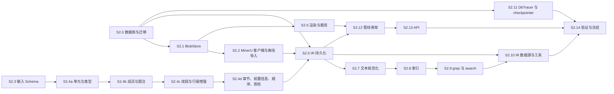

# P2 执行方案：文档底座

> 对应计划：`../phase-02-document-foundation.md`
> 周期：D2～D5 ｜ 人员：BE-1（主）、BE-4（文本、检索、Agent 接入）
> 集成分支：`phase/2-document-foundation`
> 进入条件：P1 的 `DocumentSource`、`Tracer`、`ToolRegistry` 接口已冻结

---

## 0. 执行顺序



| 检查点 | 应完成 |
|---|---|
| D2 傍晚 | S2.0、S2.3 |
| D3 中午 | S2.1、S2.4a |
| D3 傍晚 | S2.2、S2.4b、S2.7 |
| D4 中午 | S2.4c、S2.8 |
| D4 傍晚 | S2.4d、S2.5、S2.6、S2.9 |
| D5 中午 | S2.10、S2.11、S2.12 |
| D5 傍晚 | S2.13、S2.14 |

---

## S2.0 数据库与迁移

**负责 / 时长**：BE-1 / 0.5 天　**前置**：P1 完成

**产出**：`drugpaper/persistence/{db.py,models.py}`、`drugpaper/persistence/migrations/`（Alembic）、`migrations/versions/0001_core.py`

**执行**

1. 依赖：`sqlalchemy[asyncio]`、`asyncpg`、`alembic`、`pgvector`。
2. `db.py`：异步引擎、`async_session()` 上下文管理器；每个会话开始时执行 `SET app.current_user_id = :uid`（P2 固定为 `default`，P7 启用 RLS 时直接生效）。
3. 迁移 `0001_core`：
   - 扩展：`CREATE EXTENSION IF NOT EXISTS vector; CREATE EXTENSION IF NOT EXISTS pg_trgm;`
   - 表：`documents`、`parse_revisions`、`assets`、`nodes`、`relations`、`runs`、`artifacts`、`artifact_dependencies`。字段按设计文档 16.1 节，所有表带 `user_id TEXT NOT NULL DEFAULT 'default'`。
   - `nodes` 主键 `(document_id, revision, local_id)`；`geometry JSONB`；`tsv TSVECTOR`；`text_norm TEXT`。
   - 索引按设计文档 16.2 节。
4. 另建 schema `lg`，留给 LangGraph checkpointer。

**验证**

```bash
make up && uv run alembic upgrade head && uv run alembic downgrade base && uv run alembic upgrade head
```

**完成标志**：迁移可升可降；集成测试能建库、插入、查询一条节点。

---

## S2.1 BlobStore

**负责 / 时长**：BE-1 / 0.25 天　**前置**：S2.0

**产出**：`drugpaper/storage/{base.py,localfs.py}`、`drugpaper/storage/assets.py`

**执行**

1. `BlobStore` 协议：`put(data, content_type) -> ref`、`get(ref)`、`exists(ref)`、`url(ref, ttl_s)`。
2. `LocalFsBlobStore(root)`：`ref = sha256(data)`；路径 `root/{user_id}/{ref[:2]}/{ref[2:4]}/{ref}`；写入时先写临时文件再 `os.replace`（原子写入）；已存在时直接返回 ref。
3. `url()` 返回 API 代理地址 `/api/v1/blobs/{ref}`，不暴露本地路径。
4. `assets.py`：`register_asset(document_id, kind, ref, meta)` 写入 `assets` 表。

**完成标志**：并发写同一内容只保留一份；单元测试通过。

---

## S2.2 MinerU 客户端与离线导入

**负责 / 时长**：BE-1 / 0.5 天　**前置**：S2.1

**产出**：`drugpaper/parsers/mineru_legacy/client.py`、`drugpaper/parsers/mineru_legacy/importer.py`、`tests/integration/test_mineru_client.py`

**执行**

1. `MinerUClient(base_url, max_inflight, poll_interval_s, timeout_s)`：
   - `submit(pdf_bytes, filename) -> task_id`（multipart `file=`）；
   - `wait(task_id)`：轮询 `GET /api/v1/tasks/{id}`，直到 `succeeded` 或 `failed`，超时抛错；
   - `fetch(task_id) -> dict[path, bytes]`：`GET /result`，`content` 为文本、`content_base64` 为二进制；
   - 客户端侧 `asyncio.Semaphore(max_inflight)` 控制并发，低于服务端 `MAX_QUEUE`；收到 429 时退避重试。
2. 路径过滤：拒绝包含 `..`、绝对路径、盘符的文件名（沿用现有 `mineru_client.py` 的做法）。
3. `store_result(document_id, files)`：每个文件存入 BlobStore，登记为资产（`raw_layout_json`、`raw_middle_json`、`raw_content_list`、`raw_md`、`image`、`merged_image`、`origin_pdf`），创建 `parse_revisions` 记录。
4. 离线导入 `importer.import_dir(dir)`：把一个已有的 `auto/` 目录按相同方式导入，用于样例论文和 MinerU 服务不可用时的开发。

**验证**：离线导入样例论文，资产表中出现全部文件；MinerU 可用时提交一篇 PDF 端到端成功（手动）。

**完成标志**：离线导入可用；在线客户端通过模拟服务的集成测试。

---

## S2.3 输入 Schema

**负责 / 时长**：BE-1 / 0.25 天　**前置**：P1 完成

**产出**：`drugpaper/parsers/mineru_legacy/schemas.py`

**执行**

- `LayoutPage`、`LayoutBlock`、`SubBlock`、`MiddlePage`、`MiddleBlock`、`MiddleLine`、`MiddleSpan`。
- 全部 `model_config = ConfigDict(extra="allow")`；已知字段显式声明（设计文档 2.2 节的字段表），未知字段保留在 `model_extra` 中，后续写入 `source_ref.extra`。
- `bbox` 统一为 `tuple[float, float, float, float]`。

**完成标志**：样例论文的 layout.json 与 middle.json 都能无报错解析。

---

## S2.4a IR：单元识别与类型判定

**负责 / 时长**：BE-1 / 0.5 天　**前置**：S2.3

**产出**：`drugpaper/parsers/mineru_legacy/adapter/{units.py,types.py}`、`tests/unit/ir/test_units.py`

**执行**

1. 单元识别：
   - `detailed_index` 不为 None、无 `belong_to`、无 `belong_to_cross` → 原始顶层块；
   - `merged_from` 存在 → 页内合并组，成员为同页中 `belong_to == confirmed_index` 的块；
   - `merged_from_cross` 存在 → 跨页合并组，成员由 `belong_to_cross` 反查。
2. 标签正则：`^(Figure|Fig\.|Scheme|Table|Chart)\s*S?\d+[A-Za-z]?\b`，对成员文本、`caption_text`、子块文本依次匹配。
3. 类型判定（设计文档 7.3 第 3 步）：`Table` → table；`Scheme` → scheme；`Figure`/`Chart` → figure；无标签且在首页摘要区域 → figure（subtype=toc_graphic）；否则按 `parent_type`。
4. 原始块类型映射：`title` → heading；`text` → paragraph；`list` → list；`image_body` → figure；`table_body` → table；`interline_equation` → formula。

**验证**：样例论文中 p3 的合并组判定为 table 且标签为 "Table 1"；p2 的合并组为 scheme，标签为 "Scheme 1"。

**完成标志**：测试通过。

---

## S2.4b IR：成员处理与图注

**负责 / 时长**：BE-1 / 0.5 天　**前置**：S2.4a

**产出**：`adapter/members.py`、`tests/unit/ir/test_members.py`

**执行**

对每个合并组的成员依次判断：

| 条件 | 处理 |
|---|---|
| 文本匹配标签正则，或是 `image_caption`/`table_caption` 子块且匹配 | 作为 `caption` 子节点；组的 `label` 取自此处 |
| 以脚注标记开头（`^[a-z]\s*[A-Z]`，或位于表格下方且以 a/b/c 标记开头） | `footnote` 子节点；解析标记字典 `{a: "...", b: "..."}` 存入组的 attributes |
| 非图注文本，长度 > 200 字符，或以 `ABSTRACT` 开头 | 独立 `paragraph` 节点（不挂在组下），加 `absorbed_by_merge` 标记 |
| `image_body` / `table_body` 成员 | `figure_part` 子节点，保留几何 |
| 其余短文本（图内标注等） | `figure_part` 子节点，`subtype=text` |

组自身的 `caption_text` 与选出的图注不一致时（例如样例中的 `"1-10"`），加 `caption_mismatch` 标记，原 `caption_text` 保存在 `source_ref`。

**验证**：样例中摘要段落作为独立节点存在；Table 1 的标签来自 title 成员；`"1-10"` 不是图注。

**完成标志**：测试通过。

---

## S2.4c IR：续段与行级增强

**负责 / 时长**：BE-1 / 0.5 天　**前置**：S2.4b

**产出**：`adapter/continuation.py`、`drugpaper/parsers/mineru_legacy/line_enricher.py`、`tests/unit/ir/test_continuation.py`

**执行**

1. 对齐：layout 原始块 `(page_idx, detailed_index)` ↔ middle.json `pdf_info[page].para_blocks[detailed_index]`；bbox 不一致时记录告警，不对齐。
2. 有 middle.json 时：
   - 对每个段落块，取其 `lines`，按行 bbox 的 x0 与 y 做聚类，得到若干区域（左栏、右栏、下一页）；
   - 每个聚类区域与本页或下一页中 `lines_deleted=True` 的空块做包含判定：行框落在空块 bbox 内，就把该空块的 bbox 作为该段落的 `continuation` region；
   - 行级 bbox 保存在节点 attributes 的 `lines` 中（供 P8 的证据高亮到行）。
3. 无 middle.json 时：空文本块挂到阅读顺序上最近的前一个非空段落，region 标记 `derived=true`。
4. 空块本身不生成节点。

**验证**：样例 p0 的 `p000.b011` 段落有 2 个 region（左栏主体、右栏 `[314,486,556,630]`）；p1 的 `p001.b000` 空块成为 p0 右栏段落的续段 region。

**完成标志**：测试通过；随机抽查另外 2 篇论文的续段，人工确认。

---

## S2.4d IR：章节、前置信息、阅读顺序与质检

**负责 / 时长**：BE-1 / 0.5 天　**前置**：S2.4c

**产出**：`adapter/{sections.py,front_matter.py,order.py}`、`drugpaper/parsers/mineru_legacy/quality.py`、`adapter/builder.py`

**执行**

1. 章节：
   - 全大写且长度 < 60 的标题 → 一级章节；
   - 句首粗体短句（以句点结束、长度 < 80，位于段落开头）→ `heading`，不开新章节；
   - `section_role` 词典：abstract、introduction、results、discussion、experimental、conclusion、references、acknowledgments、supporting_information、abbreviations；无法判定时继承上一章节。
2. 前置信息：首页第一个 level-1 标题为论文标题；紧随其后含逗号和人名模式的文本块为作者；`Cite This:` 行抽取期刊、年份、卷页；DOI 用正则 `10\.\d{4,9}/\S+`。这些节点的 `section_role=front_matter`。
3. 阅读顺序：页内用 `confirmed_index`，跨页按页序；子节点顺序按几何位置。
4. 质检（写入 `quality_flags` 和文档级质量报告）：bbox 越界；同页非父子节点 IoU > 0.6；图注与 caption 字段不一致；合并组吞正文；资产缺失；页数不一致；扫描页（PyMuPDF 取不到文本层的页）。
5. 兼容启发式：大框完全包含小框且重叠比例 > 0.8 时，小框降为 `figure_part`；`source_ref` 中保存现有流水线的 ID（`fig_p{page}_{ci}` 等）。
6. `builder.build_ir(layout, middle | None, pdf) -> IRDocument`：串起 S2.4a～S2.4d。

**验证**：章节树包含 INTRODUCTION、RESULTS AND DISCUSSION、CONCLUSIONS、EXPERIMENTAL SECTION；标题、作者、DOI 正确；质检报告列出 F3、F4 两类告警。

**完成标志**：`tests/unit/ir/` 全部通过；生成 `tests/fixtures/jmedchem_2c00949/ir_snapshot.json`，经人工核对后提交。

---

## S2.5 IR 持久化

**负责 / 时长**：BE-1 / 0.25 天　**前置**：S2.0、S2.4d、S2.2

**产出**：`drugpaper/persistence/repos/{documents.py,nodes.py}`

**执行**

- `save_ir(document_id, revision, ir)`：单事务批量插入节点（`COPY` 或 `executemany`）、关系（contains、caption_of、continuation）；更新 `documents.status`、`quality_report`。
- 查询：`get_tree(document_id)`（只含 ID、类型、标签、子节点）、`get_node(ref)`、`nodes_on_page(document_id, page)`、`children(ref)`、`context_window(ref, before, after)`。

**完成标志**：样例论文入库后，树查询与快照一致。

---

## S2.6 渲染与裁剪

**负责 / 时长**：BE-1 / 0.25 天　**前置**：S2.1

**产出**：`drugpaper/render/pages.py`、`drugpaper/domain/geometry.py`、`tests/unit/test_geometry.py`

**执行**

1. `render_page(pdf_ref, page, dpi) -> blob_ref`：PyMuPDF `page.get_pixmap(dpi=dpi)`，PNG；缓存键 `(pdf_sha, page, dpi)`。
2. `crop(pdf_ref, region, dpi, pad=0) -> blob_ref`：按归一化 bbox 换算像素并裁剪；缓存键 `(pdf_sha, page, bbox, dpi, pad)`。
3. 坐标函数：`pt_to_norm`、`norm_to_px`、`local_to_page(local_bbox, parent_region)`、`page_to_local`。

**验证**：`local_to_page` 与 `page_to_local` 往返误差 < 1e-6；裁剪 Table 3 的图与 `merged_images` 中的图目视一致。

**完成标志**：测试通过。

---

## S2.7 文本规范化

**负责 / 时长**：BE-4 / 0.5 天　**前置**：S2.5

**产出**：`drugpaper/text/normalize.py`、`drugpaper/text/latex_rules.yaml`、`tests/unit/test_normalize.py`

**执行**

1. 规范化由一串"替换规则"组成，每条规则都记录位置变化，最终得到 `norm → raw` 的偏移数组：
   - LaTeX：`\mathrm { X }`、`\mathbf { X }` → `X`；`_ { 1 }` → `1`；`^ { \prime }` → `′`；`\mu` → `μ`；`\pm` → `±`；`\times 10 ^ { - 6 }` → `× 10^-6`；`\circ` → `°`；多余空格压缩。规则放在 `latex_rules.yaml`。
   - 行尾连字符：`xxx-\s*yyy` 中，合并后的词在词表中而 `xxx` 与 `yyy` 单独不在时，合并；化学名中的连字符（如 `4-methyl`）不合并。
   - 缺空格：只处理明显的粘连（小写字母后接大写开头的常见英文词，如 `ofthe` → `of the`），基于常用词表的最大匹配，只作用于 `text_norm`。
2. `normalize(raw) -> (norm, offsets)`；`map_span(norm_span, offsets) -> raw_span`。

**验证**：`\mathrm { D } _ { 1 }` → `D1`；`re-placement` → `replacement`；`4-methyl` 保持不变；偏移映射把 `norm` 中 "D1 receptor" 的位置准确映射回 `raw`。

**完成标志**：测试通过；样例论文全部节点规范化后抽查 20 段，无明显错误。

---

## S2.8 索引

**负责 / 时长**：BE-4 / 0.25 天　**前置**：S2.7

**产出**：`drugpaper/text/index.py`、迁移 `0002_text_index.py`

**执行**

- 入库时写 `text_norm` 与偏移（偏移存为压缩后的数组，放在 attributes 或单独的 `node_texts` 表）。
- `tsv = to_tsvector('simple', text_norm)`；GIN 索引；`text_norm` 上建 `gin_trgm_ops` 索引。
- `search(document_id, query, mode)`：`fts` 用 `websearch_to_tsquery`；`trgm` 用相似度；`hybrid` 合并两路并按分数排序。

**完成标志**：样例论文中 `search("hERG")`、`search("dopamine D1")` 返回合理结果。

---

## S2.9 grep 与 search 工具

**负责 / 时长**：BE-4 / 0.5 天　**前置**：S2.8

**产出**：`drugpaper/tools/builtin/search.py`、`tests/unit/test_grep.py`

**执行**

1. 输入输出按设计文档 7.9.3 节。实现方式：把文档所有可检索节点（本阶段为 paragraph、heading、caption、footnote、list）的 `text_norm` 按阅读顺序缓存在内存（按 `(document_id, revision)` 缓存，节点更新时失效），在 Python 中用 `re` 匹配；`literal=true` 时先 `re.escape`。
2. `scope` 过滤：页码、章节角色、节点类型。
3. 命中结果：`snippet` 为命中句加前后 `context_lines` 句（按句号切分）；`char_span` 通过偏移映射回 `text_raw`。
4. `max_results` 截断并返回 `truncated`。
5. 正则超时保护：对输入模式做长度限制，并用 `regex` 库的超时参数，防止灾难性回溯。

**验证**：`grep(r"\b26\b")` 命中摘要与正文多处，且 `char_span` 对应原文中的 "26"；`scope.sections=["experimental"]` 时只返回实验部分。

**完成标志**：测试通过。

---

## S2.10 IR 数据源与文档工具

**负责 / 时长**：BE-4 / 0.25 天　**前置**：S2.5、S2.9

**产出**：`drugpaper/docsrc/ir_source.py`、`drugpaper/tools/builtin/doc_read.py`

**执行**

- `IrDocumentSource` 实现 P1 的 `DocumentSource` 协议，并增加 `outline()`、`node(ref)`、`window(ref, n)`。
- 工具：`get_outline`、`get_node`、`get_children`、`get_context_window`、`get_section`、`get_page_text`，以及 S2.9 的 `grep`、`search`。
- `ToolResult.refs` 返回节点全局引用；Agent 答案中的引用改为节点引用，CLI 输出时附页码与 region。
- CLI 新增：`drugpaper ask --doc <document_id> "<问题>"`。

**完成标志**：P1 的 AgentRuntime 不改一行，只换数据源和工具注册，即可在 IR 上问答。

---

## S2.11 DbTracer 与 checkpointer

**负责 / 时长**：BE-4 / 0.25 天　**前置**：S2.0

**产出**：`drugpaper/tracing/db.py`

**执行**

- `DbTracer`：`run_start` 创建 `runs` 行；`model_call`、`tool_call` 作为子 Run（`parent_run_id`）写入；`run_end` 更新状态与汇总。同时保留 JSONL 输出（可配置关闭）。
- checkpointer 改为 LangGraph 的 Postgres 实现，使用 schema `lg`；`thread_id = run_id`。

**验证**：运行一次问答后，`runs` 表能查出完整的树；杀掉进程后用同一 `thread_id` 恢复，能从最后一步继续。

**完成标志**：通过。

---

## S2.12 管线骨架

**负责 / 时长**：BE-4 / 0.25 天　**前置**：S2.5、S2.6

**产出**：`drugpaper/orchestration/pipeline_graph.py`

**执行**

- LangGraph 主图的前 4 个节点：`ingest`（计算 sha256、存 PDF、建文档）→ `mineru_parse`（在线提交或离线导入）→ `build_ir`（S2.4 + S2.5）→ `render_and_index`（渲染缩略图、规范化、建索引）。
- 状态只存引用；每个节点失败时写 `documents.status=failed` 和错误码。
- 本阶段由 API 的后台任务同步调用；P5 改为 Celery 任务。

**完成标志**：一条命令完成样例论文的导入与建库：`drugpaper ingest --offline tests/fixtures/jmedchem_2c00949`。

---

## S2.13 API

**负责 / 时长**：BE-1 / 0.5 天　**前置**：S2.12

**产出**：`drugpaper/api/{app.py,documents.py,nodes.py,search.py,blobs.py}`

**执行**

| 接口 | 说明 |
|---|---|
| `POST /api/v1/documents` | multipart 上传；返回 document_id；后台运行管线 |
| `GET /api/v1/documents/{id}` | 状态、元数据、质量报告摘要 |
| `GET /api/v1/documents/{id}/tree` | 轻量树 |
| `GET /api/v1/documents/{id}/pages/{p}/image?dpi=` | 页面图 |
| `GET /api/v1/documents/{id}/pages/{p}/nodes` | 页内节点与 regions（供前端 Overlay） |
| `GET /api/v1/nodes/{node_ref}` | 节点详情 |
| `GET /api/v1/nodes/{node_ref}/crop?dpi=` | 裁剪图 |
| `GET /api/v1/documents/{id}/search?q=&mode=` | 检索 |
| `GET /api/v1/blobs/{ref}` | Blob 代理 |

统一错误格式按设计文档 15.8 节；导出 OpenAPI 到 `docs/interfaces/openapi-p2.json`，供前端 Mock。

**完成标志**：前端可以基于 OpenAPI 生成客户端；接口集成测试通过。

---

## S2.14 验证与冻结

**负责 / 时长**：BE-1、BE-4 / 0.25 天　**前置**：S2.10、S2.11、S2.13

**产出**：`scripts/verify_phase_2.py`、`docs/interfaces/document-ir.md`、`samples/outputs/phase-2/`

**执行**

`verify_phase_2.py` 依次执行：迁移 → 离线导入样例论文 → 比对 IR 快照 → 逐条检查 F1～F9 → 调用 API 取树、节点、页面图 → 两个 Agent 冒烟问题（阶段计划 6 节）→ 输出报告。

**完成标志**：阶段计划第 7 节的验收清单全部勾选；接口文档写明 `DocumentNode`、`Geometry`、`Region`、`EvidenceRef`、节点 ID 规则、API；打标签 `p2-done`。
