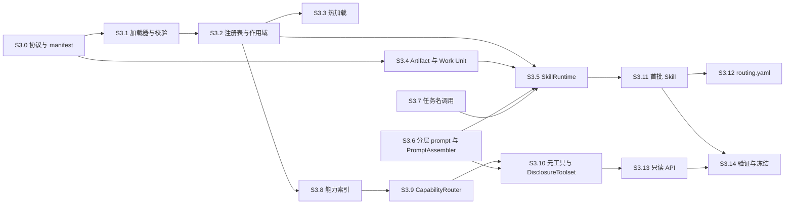

# P3 执行方案：Skill 运行时与渐进式披露

> 对应计划：`../phase-03-skill-runtime-and-disclosure.md`
> 周期：D2～D5 ｜ 人员：BE-4（主）、BE-3（prompt 与首批 Skill）、BE-1（只读 API）
> 集成分支：`phase/3-skill-runtime`
> 进入条件：P1 冻结；P2 的 S2.0（表结构）完成。节点 API 未就绪时用 `LayoutJsonSource` 做桩

---

## 0. 执行顺序



| 检查点 | 应完成 |
|---|---|
| D2 傍晚 | S3.0、S3.1 |
| D3 中午 | S3.2、S3.4、S3.6（草稿） |
| D3 傍晚 | S3.3、S3.5、S3.7 |
| D4 中午 | S3.8、S3.9 |
| D4 傍晚 | S3.10、S3.11 |
| D5 中午 | S3.12、S3.13 |
| D5 傍晚 | S3.14 |

---

## S3.0 协议与 manifest

**负责 / 时长**：BE-4 / 0.25 天　**前置**：P1

**产出**：`drugpaper/skills/protocol.py`、`docs/interfaces/skill-manifest.schema.json`

**执行**

1. `SkillManifest`：`name`、`version`、`kind`（prompt/python/graph）、`trust`、`scope`、`mode`、`accepts`、`entry`、`input_schema`、`output_schema`、`produces`、`tools`、`model_tasks`、`prompts`（含 `includes`）、`budgets`、`sandbox`、`cache.key_fields`、`fallbacks`、`validators`、`disclosure`（`audiences`、`toolkit`、`triggers`、`budgets`、`invocation`）。
2. `SkillResult`、`ArtifactDraft`、`NodeProposal`、`FactProposal`、`RelationDraft`、`QualityReport`（设计文档 9.5）。
3. `SkillContext`：`user_id`、`document_id`、`revision`、`target_ref`、`run_id`、`trace_id`、`model`（ModelClient）、`tools`（受白名单约束的调用器）、`blobs`、`budget`。
4. 导出 manifest 的 JSON Schema，供编辑器提示和 CI 校验。

**完成标志**：模型定义合入；Schema 文件生成。

---

## S3.1 加载器与校验

**负责 / 时长**：BE-4 / 0.5 天　**前置**：S3.0

**产出**：`drugpaper/skills/loader.py`、`tests/unit/skills/test_loader.py`、`tests/fixtures/skills/`（合法与非法样例包）

**执行**

1. `load_package(path) -> LoadedSkill`：读取 `manifest.yaml`、`SKILL.md`（frontmatter + 按固定标题切分小节）、schemas、prompts、references 目录索引。
2. `content_hash`：对目录下所有文件按相对路径排序后逐个哈希，汇总为目录哈希。
3. 校验项（每项一个错误码）：manifest Schema；`input_schema`/`output_schema` 可解析；`prompts` 可编译（Jinja2 `StrictUndefined`）；`includes` 引用的公共片段存在；`tools` 在 Tool 注册表中；`model_tasks` 在任务映射中；L0 ≤ 40 tokens、L1 ≤ 350 tokens（用与模型一致的 tokenizer，没有则按字符数估算）；L1 小节缺失给警告。
4. 返回 `LoadedSkill(manifest, l0, l1_sections, resources_index, prompts, content_hash, warnings, errors)`。

**验证**：合法包加载成功；每类非法包都返回对应错误码。

**完成标志**：测试通过。

---

## S3.2 注册表与作用域

**负责 / 时长**：BE-4 / 0.5 天　**前置**：S3.1

**产出**：`drugpaper/skills/registry.py`、迁移 `0003_skills.py`（`skill_versions`）

**执行**

1. 状态机：`discovered → validating → testing → staged → active`；`invalid`、`disabled`。
2. `testing`：执行包内 `tests/cases/*.json`（输入 + 期望输出或断言），`prompt` 型用 FakeLLM 回放 `cases/*.response.json`，`python` 型直接执行。
3. 作用域解析：`resolve(name, user_id)` 按 `user → system → builtin` 查找 active 版本；同名覆盖需要 `override: true`。
4. `list_visible(user_id, audience)`：返回该用户、该角色可见的 active Skill。
5. 版本标识：`name@version#content_hash`。

**完成标志**：注册、激活、停用、回滚到上一个 staged 版本均有测试。

---

## S3.3 热加载

**负责 / 时长**：BE-4 / 0.25 天　**前置**：S3.2

**产出**：`drugpaper/skills/watcher.py`

**执行**

- `watchfiles` 监听 `skills/` 与 `drugpaper/skills/builtin/`；变更的包进入 `discovered` 并走校验与测试；`auto_activate=true` 时自动激活。
- 激活后发布 Redis 消息 `skills:changed {name, version, hash}`；所有 Worker 订阅并刷新本地注册表与能力索引。
- 进行中的 Run 持有启动时解析到的版本对象，不受影响。

**验证**：往 `skills/` 放入新包，5 秒内在另一进程中可见；修改包后新 Run 使用新版本。

**完成标志**：集成测试通过。

---

## S3.4 Artifact 与 Work Unit

**负责 / 时长**：BE-4 / 0.25 天　**前置**：S3.0、S2.0

**产出**：`drugpaper/domain/{artifacts.py,work_units.py}`、`drugpaper/persistence/repos/artifacts.py`

**执行**

- `work_unit_key(skill, target_ref)`。
- `ArtifactRepo.create_version(draft)`：同一 `work_unit_key` 的旧 active 版本改为 `superseded`，新版本 `is_active=true`（唯一索引 `artifacts(work_unit_key) WHERE is_active`）。
- `add_dependencies(downstream, upstreams)`；`downstream_of(artifact_id)`（递归查询，供 P8 重跑规划）。

**完成标志**：并发创建同一 Work Unit 的版本不会出现两个 active。

---

## S3.5 SkillRuntime

**负责 / 时长**：BE-4 / 0.75 天　**前置**：S3.2、S3.4、S3.6、S3.7

**产出**：`drugpaper/skills/runtime.py`、`tests/unit/skills/test_runtime.py`

**执行**

```python
class SkillRuntime:
    async def run(self, skill_name: str, target_ref: str, inputs: dict, ctx: RunContext,
                  *, force: bool = False) -> SkillOutcome:
        skill = registry.resolve(skill_name, ctx.user_id)
        fp = input_fingerprint(skill, inputs, upstream_versions, model_task_spec)
        if not force and (hit := artifacts.find_by_fingerprint(fp)): return SkillOutcome.cached(hit)
        with tracer.span("skill_run", skill=skill.id, target=target_ref):
            if skill.kind == "prompt":  result = await self._run_prompt(skill, inputs, ctx)
            elif skill.kind == "python": result = await self._run_python(skill, inputs, ctx)
            outcome = await self.submitter.commit(skill, target_ref, result, fp, ctx)
        return outcome
```

1. `_run_prompt`：PromptAssembler 组装（公共片段 + task.md + 输入材料）→ `model.chat(task=skill.model_tasks.<key>, response_schema=output_model)` → 返回 `SkillResult`（单个 ArtifactDraft）。
2. `_run_python`：`importlib` 延迟导入 `entry`；调用 `run(inputs, ctx)`；`ctx.tools` 只允许 manifest 中声明的 Tool。
3. `Submitter.commit`（单事务）：Schema 校验 → `produces` 权限 → 子节点几何在父区域内 → 锁定保护接口（本阶段恒为未锁定）→ manifest 声明的校验器 → 写 Artifact、依赖、事实提议、RunRecord → 提交后发布 `artifact.updated`。
4. 预算：`budgets.max_model_calls`、`max_wall_time_s` 由运行时强制执行。

**验证**：用一个测试用 prompt 型 Skill 和一个 python 型 Skill 跑通执行、缓存命中、Schema 失败拒绝、越权拒绝。

**完成标志**：测试通过。

---

## S3.6 分层 prompt 与 PromptAssembler

**负责 / 时长**：BE-3（prompt）、BE-4（Assembler）/ 0.5 天　**前置**：P1

**产出**：`prompts/common/{data_boundary,mol_reference,numeric_transcription,no_hallucination}.md`、`drugpaper/capabilities/assembler.py`

**执行**

1. BE-3 从现有 `prompt_v2` 中抽出公共规则，写成 4 个片段；每个片段 ≤ 600 tokens，去掉重复表述。
2. `PromptAssembler.build(parts, budget)`：顺序为"系统规则（固定前缀）→ 任务材料 → 能力描述 → 历史 → 输出预留"。能力描述超预算时，按 L1→L0→删除低分候选的顺序降级；任务材料超预算时报错（由调用方切片），不静默截断。
3. `prompt_hash`：所有被引用片段与模板内容的哈希，进入缓存键与 RunRecord。
4. 同时实现 P1 的 `ContextAssembler` 协议，替换 `SimpleAssembler`。

**完成标志**：同一输入重复组装结果完全一致；超预算的降级行为有测试。

---

## S3.7 任务名调用

**负责 / 时长**：BE-4 / 0.25 天　**前置**：P1 的 S1.3

**产出**：`drugpaper/gateway/task_router.py`

**执行**

- 读取 `config/models.yaml` 中的 `tasks` 和 `stages`，把 `task` 映射到一个具体模型（本阶段只取阶段对应池的第一个模型，不做主备和限流）。
- `ModelClient.chat(req, task=...)` 查映射后合并任务参数（温度、max_tokens、超时、思考开关、图片尺寸上限）。
- 增加视觉模型：在 models.yaml 中加入 `vlm_strong` 与 `vlm_light`（没有轻量模型时指向同一个）。

**完成标志**：`visual_classify` 任务路由到视觉模型，`default` 路由到文本模型。

---

## S3.8 能力索引

**负责 / 时长**：BE-4 / 0.25 天　**前置**：S3.2

**产出**：`drugpaper/capabilities/index.py`、迁移 `0004_capability_index.py`

**执行**

- 条目来源：active Skill（L0、L1 小节、triggers、audiences、toolkit、invocation）与 Tool（短描述作为 L0，参数说明摘要作为 L1）。工具包本身也作为条目。
- 每个条目记录各层 token 数。
- 缓存键 `(registry_version, user_id)`；收到 `skills:changed` 时增量更新。
- 向量字段预留，默认不计算（P6 之后按需开启）。

**完成标志**：索引可按 audience、toolkit、作用域查询。

---

## S3.9 CapabilityRouter

**负责 / 时长**：BE-4 / 0.5 天　**前置**：S3.8

**产出**：`drugpaper/capabilities/router.py`、`tests/unit/capabilities/test_router.py`

**执行**

```python
def preselect(ctx: DisclosureContext) -> Disclosure:
    visible = index.visible(ctx.user_id, ctx.audience)                      # 1. 可见性
    scored = [(score(c, ctx), c) for c in visible]                          # 2. 触发匹配
    #   check_codes 精确命中 +100；image_types 精确命中 +50；intents 关键词命中 +10/词
    #   已激活的能力排除（它们已在工具列表中）
    ranked = sorted([x for x in scored if x[0] > 0], reverse=True)          # 3. 排序（同分按历史命中率）
    return pack(ranked, ctx.token_budget, l1_top=3)                         # 4. 按预算装配
```

- `pack`：前 `l1_top` 个附 L1，其余 L0；累计 token 超预算即停止。
- 返回 `Disclosure(items=[{name, level, tokens}], total_tokens)`，同时写入 `capability_disclosures`。

**验证**：阶段计划 6 节中的预选、预算用例。

**完成标志**：测试通过。

---

## S3.10 元工具与 DisclosureToolset

**负责 / 时长**：BE-4 / 0.5 天　**前置**：S3.9、S3.6

**产出**：`drugpaper/capabilities/{meta_tools.py,toolset.py}`

**执行**

1. 元工具：`find_capabilities(query, toolkit?)`、`describe_capability(name)`、`load_capability(name)`、`unload_capability(name)`、`read_skill_resource(name, section)`。它们是普通 Tool，注册到 ToolRegistry。
2. `DisclosureToolset` 实现 `ToolsetProvider`：
   - 状态 `CapabilityState(core, loaded, disclosed)` 存在 AgentState 中；
   - `tools_for(state)` 返回 `core + loaded + 元工具` 的 L2 规格；
   - `load_capability` 执行后，从下一轮起新工具出现在列表中；
   - 最多 6 个 loaded；超出按 LRU 卸载；连续 4 轮未用自动卸载；
   - 已披露过的 L1 不重复发送。
3. 调用校验：Agent 调用不在当前工具列表中的能力时，`ToolRegistry.invoke` 返回 `ok=False, error="capability not loaded"`。

**验证**：FakeLLM 脚本：`find_capabilities` → `load_capability` → 调用新工具 → `submit_answer`；断言第 3 次模型请求的工具列表中包含新工具。

**完成标志**：测试通过；P1 的问答 Agent 切换到 DisclosureToolset 后冒烟问题仍然通过。

---

## S3.11 首批 Skill

**负责 / 时长**：BE-3 / 0.75 天　**前置**：S3.5

**产出**：`drugpaper/skills/builtin/{visual_classify,paper_qualify,figure_describe}/`

**执行**

| Skill | 要点 |
|---|---|
| `visual_classify` | 13 类枚举（设计文档 7.5）；修正多路线判定规则；输入附图注与代码先验（图注前缀、`Reagents and conditions`、关键词）；输出 `evidence` 与 `confidence`；任务 `visual_classify`；分类失败时输出 `other` + `needs_review` |
| `paper_qualify` | 首页 768 px 图；输出 `{qualified, category, optimization_metrics[], reason, confidence}`；低置信度不跳过 |
| `figure_describe` | 默认 `enabled=false`；用于验证"新增 Skill 无需改代码" |

每个 Skill 都写 L0、L1、triggers，以及 3 个以上测试用例（FakeLLM 回放）。

**验证**：对样例论文所有视觉节点运行 `visual_classify`（真实模型），结果存为 Artifact；人工标注对照表 `samples/outputs/phase-3/classify_eval.csv`。

**完成标志**：用例通过；分类基线准确率记录在案。

---

## S3.12 routing.yaml

**负责 / 时长**：BE-3 / 0.25 天　**前置**：S3.11

**产出**：`config/routing.yaml`、`drugpaper/skills/routing.py`

**执行**

- 格式按设计文档 9.4 节；支持 `a+b` 合并 schema 的写法和 `{subtype}_extract` 模板。
- 加载时校验：每条链中最多一个调用视觉结构化的 Skill（D38）；引用的 Skill 都存在（P4、P5 的 Skill 暂以 `planned: true` 标记，允许缺失）。

**完成标志**：`resolve_chain(image_type) -> list[str]` 可用。

---

## S3.13 只读 API

**负责 / 时长**：BE-1 / 0.25 天　**前置**：S3.10

**产出**：`drugpaper/api/skills.py`

**执行**：`GET /skills`、`GET /skills/{name}/versions`、`GET /skills/catalog?audience=&toolkit=&q=`、`GET /skills/{name}/card`、`GET /skills/{name}/resources`、`POST /skills:reload`（管理员）。

**完成标志**：OpenAPI 更新并提供给前端。

---

## S3.14 验证与冻结

**负责 / 时长**：BE-4 / 0.25 天　**前置**：S3.11～S3.13

**产出**：`scripts/verify_phase_3.py`、`docs/interfaces/skills-and-capabilities.md`

**执行**：`verify_phase_3.py` 依次执行：加载全部内置 Skill → 热加载演示（复制一个测试 Skill 进 `skills/`，等待激活，执行）→ 样例论文分类 → 预选用例 → 动态工具集冒烟 → 输出报告。

**完成标志**：阶段计划第 7 节验收清单全部勾选；冻结 `SkillManifest`、`SkillResult`、`DisclosureContext`、`routing.yaml`、`ModelClient.chat(task=...)`；打标签 `p3-done`。

## 2026-10-01 实施与验收状态

S3.0～S3.14 开发项已完成：协议、加载/注册、热更新、执行与原子提交、缓存、分层提示、模型任务、能力索引/预选/动态工具、首批 Skill、路由、API 与接口冻结。按用户补充要求增加旧流水线 Markush/角色/回填基础 Tool、MolParser Tool 和 Python 组合 Skill；复杂图像链保留 P4/P5 planned。

验收记录见 `samples/outputs/phase-3/20261001-183351/completion.md`。26 个视觉节点完成真实分类且缓存复用通过，参考一致率 21/26（80.8%）；参考由 Codex 视觉复核，用户/领域专家签核待补。动态工具常驻元工具实际为 5 个（包含 read_skill_resource）。仓库未初始化 Git，因此 p3-done 标签待团队创建，不作为代码已经打标的声明。
