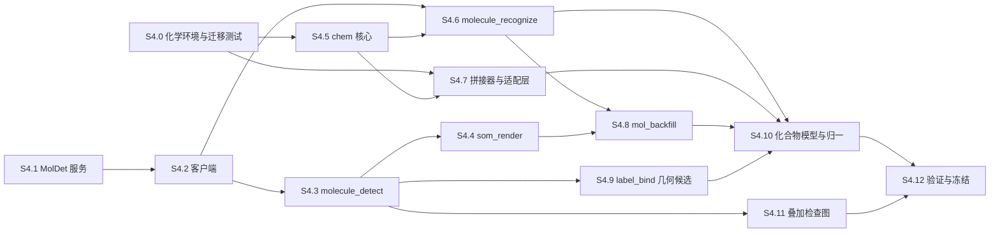

# P4 执行方案：分子链路

> 对应计划：`../phase-04-molecule-pipeline.md`
> 周期：D2～D7 ｜ 人员：BE-2（主）
> 集成分支：`phase/4-molecule`
> 进入条件：P2 的坐标函数（S2.6）与节点持久化（S2.5）；P3 的 SkillRuntime（S3.5）。未就绪时先按纯函数开发，D5 后接入

---

## 0. 执行顺序



| 检查点 | 应完成 |
|---|---|
| D2 傍晚 | S4.0 |
| D3 傍晚 | S4.1、S4.2 |
| D4 傍晚 | S4.3、S4.4、S4.5 |
| D5 傍晚 | S4.6、S4.7 |
| D6 傍晚 | S4.8、S4.9、S4.11 |
| D7 傍晚 | S4.10、S4.12 |

---

## S4.0 化学环境与迁移测试

**负责 / 时长**：BE-2 / 0.5 天　**前置**：P1

**产出**：`tests/unit/chem/legacy/`（迁移的测试）、`tests/fixtures/chem/`

**执行**

1. 依赖：`rdkit`、`numpy`、`pillow`、`opencv-python-headless`。
2. 把现有流水线的 `tests/test_esmiles_splicer.py`、`test_molecule.py`、`test_molecule_backfill.py`、`test_recognizor.py`、`test_yolo.py` 复制到 `tests/unit/chem/legacy/`，先标记为 `xfail`（被测代码尚未迁移）。
3. 确认 MolParser 服务可达：`curl http://<ip>:<port>/health`；把服务地址写入 `config/services.yaml`。

**完成标志**：迁移的测试可以被收集；MolParser 健康检查通过。

---

## S4.1 MolDet 服务

**负责 / 时长**：BE-2 / 0.75 天　**前置**：无

**产出**：`services/moldet/{app.py,model.py,settings.py,Dockerfile,README.md}`

**执行**

1. `model.py`：启动时加载 `moldet_v2_yolo11n_640_general.pt`（`ultralytics.YOLO`），设备由环境变量 `MOLDET_DEVICE` 指定（`cpu` / `cuda:0`）；加载后做一次预热推理。
2. 推理：`predict(images, conf, iou, imgsz, agnostic_nms=True)`，按批大小分批。
3. 每个结果输出：`input_index`、`width`、`height`、`boxes[{xyxy_px, xywh_norm, confidence, cls}]`；打不开的图输出空列表并带 `error`，不影响其他图的位置。
4. `app.py`（FastAPI）：
   - `POST /detect`：multipart `files[]` 或 JSON `{images: [b64]}`，参数 `conf=0.15`、`iou=0.15`、`imgsz=640`；
   - `GET /health`：模型是否加载、设备、队列长度；
   - 服务间认证：请求头 `X-Service-Token`（P7 统一接入，本阶段先实现校验逻辑，令牌来自环境变量）。
5. 推理放在线程池中执行，不阻塞事件循环；并发上限由信号量控制。
6. Dockerfile：CPU 与 GPU 两个 target。

**验证**

```bash
docker build -t moldet:cpu --target cpu services/moldet && docker run -p 8010:8010 moldet:cpu
curl -F files=@tests/fixtures/jmedchem_2c00949/merged_images/<Scheme1>.jpg http://localhost:8010/detect
```

返回的框数量与现有流水线 `molecule_detection_results.json` 中的结果一致（阈值相同）。

**完成标志**：服务可运行；迁移的 `test_yolo.py` 坏图用例改写为服务测试并通过。

---

## S4.2 客户端

**负责 / 时长**：BE-2 / 0.5 天　**前置**：S4.1

**产出**：`drugpaper/gateway/{moldet.py,molparser.py}`、`tests/unit/gateway/test_molparser.py`

**执行**

1. `MolDetClient.detect(images) -> list[DetectResult]`：按 `input_index` 对齐；重试 2 次。
2. `MolParserClient`（迁移 `recognizer/recognizor.py`）：
   - 保留 `recognize_files`、`recognize_json`、`health`、`extract_esmiles`（`esmi → caption → raw_caption`）；
   - `recognize(images, rec_only=True)`：每批 ≤ 32 张；发请求前查 `/health`，`queue_size / queue_maxsize > 0.8` 时等待；结果按 `input_index` 绑定，缺失的单张重试 1 次；
   - 修复：混合输入的顺序问题（统一走 multipart，URL 先下载）；不存在的文件与 base64 的误判；统一端口配置。
3. 两个客户端都使用共享的 `httpx.AsyncClient`，带连接池。

**完成标志**：`test_recognizor.py` 迁移用例通过；新增"返回数量不一致时按 input_index 绑定"的用例通过。

---

## S4.3 molecule_detect

**负责 / 时长**：BE-2 / 0.75 天　**前置**：S4.2、S2.6、S3.5

**产出**：`drugpaper/skills/builtin/molecule_detect/`、`drugpaper/vision/boxes.py`

**执行**

1. 输入：视觉节点 ref。按节点的每个 region（跨页合并图的每个 segment）以 300 dpi 裁剪，分别检测。
2. 后处理（`boxes.py`，纯函数，逐条单测）：
   - `pad_relative(box, ratio=0.04)`：按框宽高外扩并裁剪到父区域；
   - `is_whole_image(boxes, img_area)`：面积并集 / 图像面积 > 0.95；
   - `nested_mask_regions(boxes, threshold=0.45)`：返回每个大框需要涂白的小框区域；
   - `filter_small(boxes, min_ratio=0.015)`；
   - `reading_order(boxes)`：按行分组（y 中心差 < 行高的一半）后按 x 排序，编号从 0 开始，即 `mol_id`。
3. ID 对齐：与该节点已有的 molecule 子节点按 IoU ≥ 0.7 匹配，匹配上的沿用 ID，新增的取下一个序号，消失的标记 `removed`。
4. 以 `NodeProposal` 提交 molecule 子节点：`local_bbox`、`parent_region_index`、`attributes{confidence, cls, reading_index, masked_regions}`。
5. SAR 表母核候选：表格节点中位于最上方、面积最大的框标记 `is_scaffold_candidate`（最终由 E-SMILES 是否含 R 标记确认）。
6. 回退：检出 0 个框时返回 `status=needs_fallback`，由 P5 的 FigureAgent 决定是否用 MolParser 检测或 VLM grounding。

**验证**：样例论文 Scheme 1、Figure 2、Table 1 的框数量与人工标注对比，记录差异；ID 稳定性测试。

**完成标志**：单测通过；样例论文检测结果入库。

---

## S4.4 som_render

**负责 / 时长**：BE-2 / 0.25 天　**前置**：S4.3

**产出**：`drugpaper/skills/builtin/som_render/`、`drugpaper/vision/som.py`

**执行**

- 在节点裁剪图上画红色框（线宽随图像尺寸自适应），框右上角标蓝色 `mol_id`（白底描边，避免与图内容混淆）。
- 标注图缓存键 `(crop_hash, boxes_hash)`；作为 Artifact（`artifact_type=som_image`）保存。
- 修复现有 `utils_yolo.draw_bbox_xywh` 的扩框问题（改用 S4.3 的相对外扩）。

**完成标志**：样例 Scheme 1 的标注图人工检查：编号清晰、不遮挡原子标签。

---

## S4.5 chem 核心

**负责 / 时长**：BE-2 / 0.5 天　**前置**：S4.0

**产出**：`drugpaper/chem/{esmiles.py,normalize.py,formula.py,roles.py}`

**执行**

1. `esmiles.split(e_smiles) -> (core, extension)`：按第一个 `<sep>` 切分，extension 原样返回。
2. `esmiles.parse(e_smiles)`：迁移 `Translator.parse_caption / parse_groups / refactor`，返回 groups（`<a>`、`<r>`、`<c>`、`<d>` 等）、`markush`、`sru`。
3. `normalize.canonical(smiles_core) -> CanonicalResult`：RDKit 解析（失败返回错误）、sanitize、canonical SMILES、InChIKey、分子式（`CalcMolFormula`）。
4. `formula.parse_hrms(text)`：解析 `calcd for C14H14FNO2S [M+H]+` 等写法，得到分子式与加合离子（P6 使用）。
5. `roles.infer_from_esmiles(e_smiles)`：迁移 `infer_molecule_type_from_esmiles` 的保守规则。
6. 原样保留校验：`assert_roundtrip(raw, stored)` 逐字节比较。

**完成标志**：`test_molecule.py` 迁移用例由 xfail 转为通过。

---

## S4.6 molecule_recognize

**负责 / 时长**：BE-2 / 0.5 天　**前置**：S4.2、S4.5

**产出**：`drugpaper/skills/builtin/molecule_recognize/`、迁移 `0005_chem.py`（`compounds`、`compound_aliases`、`structure_candidates`、`markush_scaffolds`、`rgroup_assignments`）

**执行**

1. 输入：一个节点下所有 active 的 molecule 子节点。按 S4.3 的 `masked_regions` 涂白后裁剪（300 dpi）。
2. 批量调用 MolParser；每个结果生成 `StructureCandidate(source=ocsr)`：`e_smiles_raw`、`smiles_core`、`canonical_smiles`、`inchikey`、`formula`、`is_markush`、`validation`。
3. RDKit 解析失败：候选标记 `invalid`，节点标记 `needs_review`；该信号在 P5 用于识别误检。
4. 分子角色初判写入 molecule 节点的 attributes。
5. 单个分子的 Work Unit 为 `molecule_recognize:<molecule_ref>`，支持单独重跑（P8 使用）。

**验证**：化合物 3、26 的结构与期望 SMILES 的 InChIKey 一致；E-SMILES 往返逐字节一致。

**完成标志**：样例论文全部分子识别完成并入库。

---

## S4.7 拼接器与适配层

**负责 / 时长**：BE-2 / 0.5 天　**前置**：S4.0、S4.5

**产出**：`drugpaper/chem/splicer/{esmiles_splicer.py,LICENSE.MolParser}`、`drugpaper/chem/markush.py`

**执行**

1. 原样迁移 `esmiles_splicer.py` 与许可证文件。
2. `markush.substitute(scaffold_esmiles, definitions, max_outputs=64) -> SubstituteResult`：
   - prime 编入键名（`R'` → `R_prime`），同时改写 scaffold 中的标签；
   - 值为 `H` 时映射为 `[H]`，产物调用 `Chem.RemoveHs` 后重新 canonical；
   - 预估组合数（各变量取值数之积 × 环组位点数），超过 `max_outputs` 直接返回 `too_many_outputs`；
   - 统一返回 `products: list[str]`；
   - `ValueError` 映射为 `undefined_variable`、`bridge_attachment`、`no_valid_product`、`too_many_outputs`、`invalid_scaffold`。
3. `markush.assemble_row(scaffold, assignment)`：逐行单值调用（保证一行中同一标签取同一值）；位置变量列（表头含 `position`）跳过并返回 `assembly_skipped: positional_variable`。

**完成标志**：`test_esmiles_splicer.py` 的 11 个用例通过；新增 prime、`[H]`、组合数上限、位置变量四个用例通过。

---

## S4.8 mol_backfill

**负责 / 时长**：BE-2 / 0.5 天　**前置**：S4.4、S4.6

**产出**：`drugpaper/skills/builtin/mol_backfill/`、`drugpaper/facts/backfill.py`

**执行**

1. 迁移 `Utils/molecule_backfill.py`：`BackfillContext.resolve`、10 类 schema 的 handler、`record_unreferenced_molecules`、`annotate_image_molecule_types`。
2. 改造：
   - 输入改为 `(node_ref, extraction_payload)`，分子索引来自该节点的 molecule 子节点与其 active StructureCandidate；
   - 支持 `mol_ids` 列表；
   - 不原地修改：输出新的回填结果，原始抽取结果作为独立 Artifact 保留；
   - 错误码沿用，每条带 `field_path` 与 `available_mol_ids`。
3. 回填结果以 FactProposal 提交：编号绑定（`LabelClaim`）、结构绑定、角色标注。

**完成标志**：`test_molecule_backfill.py` 迁移用例通过；新增 `mol_ids` 用例通过。

---

## S4.9 label_bind 几何候选

**负责 / 时长**：BE-2 / 0.25 天　**前置**：S4.3、S2.4c

**产出**：`drugpaper/skills/builtin/label_bind/`

**执行**

- 对每个分子框，在其下方与右侧 1.5 倍框高范围内收集候选标签。候选来源：
  - middle.json 中落在该范围的文本 span（矢量 PDF）；
  - 该节点 `figure_part` 子节点的短文本。
- 标签规范化：去粗体标记，统一 `‑ − –` 为 `-`，识别 `\d+[a-z]?`、`\(([RS])\)-\d+`、`[A-Z]{2,}-\d+`。
- 输出每个框的候选列表与几何得分；不调用模型。最终绑定由 P5 的结构化调用完成。

**完成标志**：样例 Figure 2 中每个分子框都有正确的候选标签（人工核对）。

---

## S4.10 化合物模型与归一

**负责 / 时长**：BE-2 / 0.75 天　**前置**：S4.6、S4.7、S4.8、S4.9

**产出**：`drugpaper/facts/{compounds.py,labels.py,resolver.py}`

**执行**

1. `labels.normalize(label)`：规范化编号；`labels.expand_range("16−27")`。
2. `resolver.resolve(document_id, scope=None)`：
   - 收集来源：LabelClaim（回填）、SAR 行（`rgroup_assignments`）、正文编号提及（本阶段用正则扫描 `text_norm`）；
   - 按规范化编号分组，建立或更新 Compound；
   - 别名：同一句中 `26 [UCM-1306` 或 `26 (UCM-1306)` 模式；
   - 立体变体 `(S)-26` 独立建化合物，`stereo_parent_id` 指向 26；
   - 结构采纳优先级：人工 > OCSR（分子式与 HRMS 一致，本阶段 HRMS 暂缺时看 RDKit 合法性）> Markush 组装 > OCSR 低置信；
   - 候选 InChIKey 不一致时生成 Conflict（先比前 14 位，再比完整键）。
3. 增量模式：`scope=[compound_id...]` 时只重算这些化合物（P8 重跑使用）。

**验证**：用手工构造的 Table 1 抽取结果跑一遍回填 + 组装 + 归一；样例论文中 26 与 UCM-1306 归为同一化合物。

**完成标志**：测试通过。

---

## S4.11 叠加检查图

**负责 / 时长**：BE-2 / 0.25 天　**前置**：S4.3

**产出**：`scripts/debug_molecule_overlay.py`

**执行**：把文档中所有 molecule 子节点的页面坐标画回 144 dpi 页面图，保存到 `samples/outputs/phase-4/overlay/page_XX.png`。用于人工核对坐标换算，也作为 P8 前端分子框层的对照。

**完成标志**：样例论文每页的叠加图经人工确认，框与结构对齐。

---

## S4.12 验证与冻结

**负责 / 时长**：BE-2 / 0.25 天　**前置**：S4.10、S4.11

**产出**：`scripts/verify_phase_4.py`、`docs/interfaces/chemistry.md`

**执行**：`verify_phase_4.py` 依次执行：迁移用例 → MolDet 与 MolParser 健康检查 → 样例论文检测、识别、标注图 → 化合物 3、26 结构比对 → 构造数据的回填、组装、归一流程 → 输出报告。

**完成标志**：阶段计划第 7 节验收清单全部勾选；冻结 `MoleculeBox`、`StructureCandidate`、`Compound`、`RGroupAssignment`、MolDet 服务接口；打标签 `p4-done`。

## 2026-10-01 Tool 基础提前实现

按用户要求完成 YOLO 检测服务和 molecule.detect / molecule.detections / molecule.crop / som.render 的注入、共享 Worker、多用户轮转队列与资产隔离，并使用真实权重验证。接口见 `docs/interfaces/molecule-detection-tool.md`。该完成记录仅覆盖 Tool 基础，不能代表 P4 的分子节点投影、正式识别对齐或全部 Skill 已完成。


## 2026-10-02 P4 开发完成记录

S4.0～S4.12 已实现，每项单元测试位置见 `docs/codemap/phase-4-codemap.md`。全量450项单元、6项 PostgreSQL 集成测试通过；真实验收报告位于 `samples/outputs/phase-4/20261002-final/report.json`，包含迁移/化学回归、54个识别候选、3/26结构比对和17页叠加图。

执行调整：共享服务沿用 YOLO_* 参数和既有单图 /detect，新增 /detect/batch 与 /detect/files；CPU/GPU Docker target 从工程根目录构建，当前实测部署为 systemd GPU Worker。小框阈值使用短边比例以避免面积过滤漏检路线图。外部 MolParser 并发批次索引异常按单图独立补救，不按列表位置猜测。

S4.9的几何候选已实现并单测，但真实 Figure 2 编号在位图中，不含文本 span，无法满足“每框都有正确标签”这一示例要求；位图结构化与最终绑定由 P5 接续。S4.11已生成全页叠加并由 Codex检查主要坐标，独立人工专家签核待补充。其余化学/识别/构造 SAR 整链/接口冻结验收通过。无 Git 仓库，未打 p4-done 标签。
