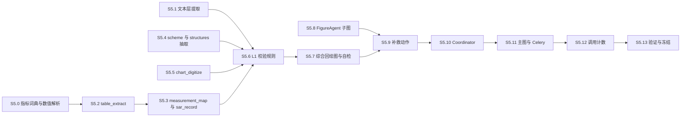

# P5 执行方案：图像理解多 Agent

> 对应计划：`../phase-05-figure-agents.md`
> 周期：D4～D9 ｜ 人员：BE-3（结构化 Skill、校验、自检）、BE-4（FigureAgent、Coordinator、管线）
> 集成分支：`phase/5-figure-agents`
> 进入条件：P3 冻结；P4 的 S4.3、S4.4、S4.6、S4.8 完成（D6 前可用构造数据开发结构化 Skill）

---

## 0. 执行顺序

| 检查点 | 应完成 |
|---|---|
| D5 傍晚 | S5.0、S5.1、S5.8（骨架） |
| D6 傍晚 | S5.2、S5.4 |
| D7 傍晚 | S5.3、S5.5、S5.6 |
| D8 中午 | S5.7、S5.9 |
| D8 傍晚 | S5.10、S5.11 |
| D9 傍晚 | S5.12、S5.13 |

---

## S5.0 指标词典与数值解析

**负责 / 时长**：BE-3 / 0.75 天　**前置**：P3

**产出**：`config/metric_dictionary.yaml`、`drugpaper/facts/{metric_dictionary.py,value_parser.py,units.py}`、`tests/unit/facts/test_value_parser.py`

**执行**

1. 词典：覆盖用户 JSON 中 `分子数据指标` 的全部键，另外收录 Cmax、Tmax、AUC、F%、CLint、Vss、solubility、Kd、Ki、IC50、EC50、% inhibition、% maximum increase、serum stability、liver homogenate stability。每项包含 `id`、`display`、`category`、`export_key`、`synonyms`（支持 `表头|footnote~关键词` 联合规则和 `:typo` 标注）、`default_units`、`unit_class`、`hard_range`、`soft_range`。
2. 匹配：精确同义词 → 表头 + 脚注联合规则 → 编辑距离 ≤ 2 的模糊匹配（记录 `normalization_warning`）→ 未命中返回 `unmapped:<原表头>`。
3. `value_parser.parse(text) -> ParsedValue`：支持设计文档 8.6 中的全部格式，以及 Unicode 减号、`×10−6`、`x 10^-6`、`1.2e-3`、范围 `2–4`、`~3.5`、`≈`、百分号、括号内的次级值。
4. `units.py`：基于 `pint` 的单位注册表，加入药学单位（μM、nM、mL/min/kg、L/kg、ng/mL、ng·h/mL、cm/s、10^-6 cm/s）；`to_si(value, unit)`；`unit_class(unit)`。

**验证**：`test_value_parser.py` 覆盖不少于 40 个样例（从现有流水线产物和样例论文中收集）；样例 Table 3 的 11 个表头全部映射正确，其中 `CYP34A` 带规范化告警。

**完成标志**：测试通过。

---

## S5.1 文本层提取

**负责 / 时长**：BE-3 / 0.25 天　**前置**：P2

**产出**：`drugpaper/vision/text_layer.py`

**执行**

- `words_in_region(pdf_ref, region) -> list[Word]`：PyMuPDF `page.get_text("words")`，按 region 过滤，坐标归一化。
- `numeric_tokens(words)`：抽出数字 token，并做与 `value_parser` 一致的规范化，例如 `24 × 10−6` 拆成的多个 token 能够重组。
- 扫描页（无文本层）返回空列表并标记 `no_text_layer`。

**验证**：样例 Table 3 区域内能取到 50、79、21、93、65、3、9、49、38、37 等全部数值。

**完成标志**：通过。

---

## S5.2 table_extract

**负责 / 时长**：BE-3 / 1 天　**前置**：S5.0、P4 的 S4.4

**产出**：`drugpaper/skills/builtin/table_extract/`

**执行**

1. 输入材料（全部由确定性步骤准备）：表格裁剪图（含结构时用标注图）、候选 `mol_id` 列表、图注、脚注文本、引用该表的正文段落摘录、文本层 token 列表（作为转写参考，提示模型"以图为准，文本层仅供核对"）。
2. prompt：公共片段 `mol_reference`、`numeric_transcription`、`no_hallucination` + `task.md`（迁移 `sar_new.md` 的规则，见设计文档 8.5）。
3. 输出 `TableGrid`（含 `Cell.mol_id`、`markers`、`row_span`/`col_span`、可选 `bbox`、`status`）。
4. 切片：图像超过任务的 `image_max_side` 且缩放后字高 < 8 px 时，按行带切片（重叠 10%），每片 1 次调用，合并时按重叠行去重。切片次数计入例外计数。
5. 后处理：按 span 展开表头；列数校验；标签列识别。

**验证**：样例 Table 1、Table 2、Table 3（真实模型）；输出与人工标注对比，单元格精确匹配率记录在案。

**完成标志**：三张表的结果入库；用例回放测试通过。

---

## S5.3 measurement_map 与 sar_record

**负责 / 时长**：BE-3 / 0.5 天　**前置**：S5.2、P4 的 S4.7、S4.8

**产出**：`drugpaper/skills/builtin/{measurement_map,sar_record}/`、`drugpaper/facts/{measurements.py,assays.py}`

**执行**

1. `measurement_map`（确定性为主）：确定主体（行化合物或 `subject_compound_label`）→ 列语义（词典）→ 条件（脚注）→ 数值解析 → Measurement 与 Assay 提议；未映射列批量交给 LLM 判定 1 次（任务 `metric_map_fallback`，计入例外）。
2. `sar_record`：母核（`is_scaffold_candidate` 且 E-SMILES 含 R 标记）→ 变量定义（非测定列）→ 每行 RGroupAssignment → 调用 `markush.assemble_row`。
3. 证据：每个 Measurement 指向 `table_node + cells[r][c]`，有单元格 bbox 时带 region。

**验证**：样例 Table 3 → 11 条 Measurement，Assay 条件正确（PAMPA、10 μM hERG、CYP 10 μM 荧光法）；Table 1 → 10 条 RGroupAssignment（位置变量行跳过组装）。

**完成标志**：测试通过。

---

## S5.4 scheme 与 structures 抽取

**负责 / 时长**：BE-3 / 0.75 天　**前置**：P4 的 S4.4、S4.9

**产出**：`drugpaper/skills/builtin/{scheme_extract,structures_extract}/`

**执行**

1. `scheme_extract`：合并 `flow.md` 与 `flow_multi_lines.md` 为一个 Skill，按 image_type 切换 schema；保留设计文档 8.14 中合成路线的 7 条规则；增加 `status` 与 `evidence_text`。
2. `structures_extract`：迁移 `structure.md`；输入附 S4.9 的几何候选标签，由模型确认最终绑定（编号绑定在这一次调用中完成）。
3. 结构化之后自动接 `mol_backfill`。
4. 路线边以 Relation（`transforms_to`）提议。

**验证**：样例 Scheme 1～5、Figure 1、Figure 2；路线边与人工标注对比。

**完成标志**：结果入库；回放测试通过。

---

## S5.5 chart_digitize

**负责 / 时长**：BE-3 / 1 天　**前置**：S5.0

**产出**：`drugpaper/skills/builtin/chart_digitize/`、`drugpaper/vision/chart_cv.py`

**执行**

1. 一次结构化调用：图表类型、坐标轴（标题、单位、对数与否）、刻度标签及像素位置、图例（文本与颜色描述）、系列、误差线、类别轴；对颜色无法区分的系列直接给出像素点列表。
2. `chart_cv.calibrate(ticks)`：线性或 log10 回归；残差 > 2% 轴长时剔除离群刻度重拟合；有效刻度 < 2 时返回失败。
3. `chart_cv.extract_series(image, legend_colors, plot_area, chart_type)`：Lab 空间颜色聚类 → 掩膜 → 柱体取柱顶、散点取质心、折线逐列取中位 y → 像素转数据坐标。
4. `chart_cv.overlay(image, dataset)`：回绘叠加图；`overlap_iou(dataset, masks)` 计算回绘重合度。
5. `property_plot` 合并 schema：同一次调用中输出数据点与 `mol_id` 的对应。
6. 按化合物分组的数据写入 Measurement（`status=estimated`）。

**验证**：用 matplotlib 合成 20 张已知数据的柱状图、折线图、散点图（含对数轴），数据点相对误差中位数 < 3%；样例论文中的图表人工检查叠加图。

**完成标志**：合成数据测试通过。

---

## S5.6 L1 校验规则

**负责 / 时长**：BE-3 / 0.75 天　**前置**：S5.1～S5.5

**产出**：`drugpaper/validators/figure/{structure.py,numeric.py,chart.py,content.py,codes.py}`

**执行**

1. `codes.py`：检查码表（名称、维度、严重级别、说明、默认触发的补救动作）。示例：

| 码 | 维度 | 条件 |
|---|---|---|
| `C_CLASS_PRIOR` | 结构 | 分类与先验冲突 |
| `C_NO_BOX` | 结构 | 应有结构但检出 0 框 |
| `C_OCSR_FAIL` | 结构 | 识别失败率 > 30% |
| `C_UNREF_BOX` | 结构 | 未引用框 > 30% |
| `C_BACKFILL_ERR` | 结构 | 回填错误 |
| `C_LABEL_UNKNOWN` | 结构 | 编号在黑板中找不到的比例 > 50% |
| `C_TEXT_LAYER_MISS` | 数值 | 文本层未命中率 > 10% |
| `C_VALUE_PARSE` | 数值 | 数值不可解析 |
| `C_UNIT_CLASS` | 数值 | 单位与指标类型不符 |
| `C_RANGE_HARD` / `C_RANGE_SOFT` | 数值 | 超出硬 / 软范围 |
| `C_MAGNITUDE` | 数值 | 列内数量级异常 |
| `C_ROW_COUNT` | 数值 | 行数与图注编号区间不符 |
| `C_AXIS_RESIDUAL` | 图表结构 | 刻度拟合残差过大 |
| `C_AXIS_SCALE` | 图表结构 | 轴类型判断错误 |
| `C_LEGEND_MISMATCH` | 图表结构 | 图例数 ≠ 系列数 |
| `C_OVERLAY_IOU_LOW` | 图表结构 | 回绘重合度 < 0.6 |
| `C_PANEL_COUNT` | 图表结构 | Panel 标签数 ≠ 拆分数 |
| `C_HEADER_SPAN` | 图表结构 | 表头展开后列数不一致 |
| `C_ROUTE_TOPOLOGY` | 图表结构 | 路线边指向不存在的节点 |
| `C_ENTITY_UNTRACEABLE` | 内容 | 描述中的实体无出处 |
| `C_CAPTION_MISMATCH` | 内容 | 与图注主题不符 |
| `C_STATUS_UNCLEAR` | 内容 | 抽取返回 unclear |
| `C_REQUIRED_EMPTY` | 内容 | 关键字段为空 |

2. 每条规则是纯函数 `check(figure_ctx) -> list[CheckResult]`，逐条单测。

**完成标志**：每个检查码至少 1 个正例和 1 个反例测试。

---

## S5.7 综合回绘图与自检

**负责 / 时长**：BE-3 / 0.5 天　**前置**：S5.6

**产出**：`drugpaper/vision/overlay.py`、`drugpaper/validators/figure/checklist.py`、`drugpaper/skills/builtin/figure_self_check/`

**执行**

1. 综合回绘图：分子框旁标编号；表格单元格旁标转写值（小字号、半透明底）；图表叠加刻度线与数字化点。
2. 核对清单：优先级为 L1 告警 → 未经文本层验证的数值 → 编号与结构 → 路线边 → 内容项；按 token 预算截断，其余标 `unchecked`。
3. `figure_self_check` prompt 型 Skill：任务 `figure_self_check`；输出 `ReviewResult`；判定规则为无 `incorrect` 且 `unsure` ≤ 10%。

**验证**：人为把 Table 3 的一个值改错后自检，能被判为 `incorrect` 并给出正确值（真实模型）。

**完成标志**：回放测试通过；真实模型演示通过。

---

## S5.8 FigureAgent 子图

**负责 / 时长**：BE-4 / 0.75 天　**前置**：P3、S5.2 的接口

**产出**：`drugpaper/agents/figure/{graph.py,state.py,report.py}`

**执行**

1. 节点：`classify` → `plan`（`routing.resolve_chain`）→ `prepare`（检测、识别、标注图、文本层、图注、引用段落、黑板摘录）→ `structure`（链中唯一的结构化 Skill）→ `post`（回填、测定映射、SAR、组装、CV）→ `check_l1` → `check_l2` → `remediate` / `verify` → `report`。
2. 模式：`full`、`query`、`review`（设计文档 7.7.3）。
3. 预算：结构化前的 3 次固定调用不计入补救预算；补救 `max_rounds=2`、`max_model_calls=4`、`max_wall_time=180s`。
4. `FigureReport` 组装与提交（写 `figure_reports` 表）。
5. 每个节点结束写 checkpoint（只在 Skill 边界）。

**完成标志**：FakeVLM 下三条路径（通过、补救后通过、预算耗尽）的测试通过。

---

## S5.9 补救动作

**负责 / 时长**：BE-4 / 1 天　**前置**：S5.7、S5.8

**产出**：`drugpaper/agents/figure/remediation.py`、`drugpaper/skills/builtin/remediation_actions/`（每个动作一个带 `disclosure` 的 manifest，`invocation: action_enum`）

**执行**

1. 动作清单：`redetect`、`recognize_region`、`rebind_labels`、`reslice_table`、`retranscribe_cells`、`recalibrate_axes`、`reclassify`、`split_panels`、`apply_review_fix`、`apply_text_layer`、`fix_unit`、`grep`/`search`、`lookup`（接口先留，P6 实现）、`get_figure_report`、`give_up`。
2. 每个动作的 manifest 声明 `triggers.check_codes`（取自 S5.6 的码表）。
3. `remediate` 节点：`CapabilityRouter.preselect(audience=figure_agent, phase=remediate, failed_checks=...)` → 2～4 个动作的 L1 卡片 → 任务 `remediate_decide` 的结构化输出 `{action, params, reason}` → 执行。
4. `verify`：全量 L1 + 只针对补救项的 VLM 核对（任务 `figure_remediate_vision`）。
5. 来源标注：`apply_review_fix` → `source=vlm_review`；`apply_text_layer` → `source=text_layer`。

**验证**：阶段计划 6 节的补救用例；预选用例（`C_AXIS_RESIDUAL` 只给相关动作）。

**完成标志**：测试通过。

---

## S5.10 Coordinator

**负责 / 时长**：BE-4 / 0.75 天　**前置**：S5.9、P4 的 S4.10

**产出**：`drugpaper/agents/coordinator/{blackboard.py,dispatch.py,reconcile.py}`

**执行**

1. 黑板 v1：标题、摘要、正文编号清单（正则 + 区间展开）、图注索引、图 → 引用段落（正则匹配 "Figure 2"、"Table 3"、"Scheme 1" 等）、靶点候选。
2. 分发：按页序派发；同页结构类优先；文档级 `asyncio.Semaphore(6)`。
3. Reconcile：按设计文档 7.7.6 的冲突表生成定向问题；每轮 ≤ 8 个，按对主路线的影响排序；同一图的问题合并；以 `query` 模式派发。
4. 黑板 v2：汇总后的化合物清单。

**验证**：构造"两张图对 12a 给出不同结构"的场景，生成两条定向问题并分别派发；构造"表格编号在任何图中都没有结构"的场景。

**完成标志**：测试通过。

---

## S5.11 主图与 Celery

**负责 / 时长**：BE-4 / 0.5 天　**前置**：S5.10、P2 的 S2.12

**产出**：`drugpaper/orchestration/pipeline_graph.py`（扩充）、`drugpaper/workers/{celery_app.py,tasks.py}`、`docker-compose.yml`（加 worker 服务）

**执行**

1. 主图：在 P2 的 4 个节点之后加入 `build_blackboard` → `dispatch`（Send 扇出 `figure_agent`）→ `compound_resolve` → `reconcile`（有问题时再次 Send）→ 结束（P6 继续扩充）。
2. Celery：队列 `batch`、`interactive`；任务 `process_document(document_id)`，`acks_late=True`，可见性超时 > 最长管线时间；任务内 `asyncio.run(graph.ainvoke(...))`。
3. 恢复：任务重投后以相同 `thread_id` 恢复；已完成 Skill 命中缓存。
4. 基础限流：Redis 信号量按模型端点计数（P7 替换）。
5. API：`POST /batches`、`GET /batches/{id}`；上传后进入 Celery 队列。

**验证**：处理中途 `docker kill` Worker，重启后继续完成，模型调用总数与不中断时一致（缓存命中）。

**完成标志**：10 篇批量运行成功率 ≥ 90%。

---

## S5.12 调用计数

**负责 / 时长**：BE-4 / 0.25 天　**前置**：S5.11

**产出**：`drugpaper/agents/figure/accounting.py`

**执行**：每图记录 `fixed_calls`（应为 3）、`exception_calls`（切片、复判、映射兜底）、`remediation_calls`；每篇汇总；超出例外上限时写告警。输出到文档质量报告。

**完成标志**：样例论文的报告中每图的调用构成清楚可查。

---

## S5.13 验证与冻结

**负责 / 时长**：BE-3、BE-4 / 0.25 天　**前置**：S5.12

**产出**：`scripts/verify_phase_5.py`、`docs/interfaces/figure-agents.md`

**执行**：`verify_phase_5.py` 依次执行：样例论文全量运行 → 检查每图都有 FigureReport → Table 3 的 11 项测定比对 → 补救与定向复核的演示用例 → 10 篇批量运行统计（成功率、每篇调用数、耗时分解）→ 输出报告，并与设计文档 7.6 的预算对比。

**完成标志**：阶段计划第 7 节验收清单全部勾选；冻结 `FigureReport`、`TableGrid`、`ChartDataset`、`Measurement`、`Assay`、检查码表、`routing.yaml`；打标签 `p5-done`。

## 开发与验收记录（2026-10-02）

S5.0～S5.12已实现并覆盖单元/集成测试；S5.13接口冻结完成，真实抽取验收尚以completion.md为准。实际目录集中为 facts/figure_models.py、table_processing.py、skills/figure.py，避免将测定模型/处理重复拆散；CLI/API入口与新增图像主图独立于P2解析主图，并通过understand_figures显式衔接。

执行编号映射：S5.0 数值/词典 → test_values_and_tables；S5.1 文本层 → 同文件真实PDF测试；S5.2 切片 → test_table_slicing；S5.3 测定/SAR → test_values_and_tables、test_persistence_and_modes；S5.4 路线/结构 → 包注册回放及事实投影；S5.5 图表 → test_chart；S5.6 L1 → test_validation_and_disclosure；S5.7 L2/回绘 → 同文件清单/材料/封闭核对；S5.8 Agent → test_agent；S5.9 补救 → test_agent、test_validation_and_disclosure；S5.10 Coordinator → test_coordinator_and_pipeline；S5.11 管线/恢复 → test_api_and_worker、test_figure_resume、test_celery_recovery；S5.12 计数 → test_agent和文档质量统计；S5.13 冻结/真实验收 → docs/interfaces/phase-5及scripts/verify_phase_5.py。

当前部署为systemd，因此Worker硬终止恢复采用独立Celery子进程SIGKILL，而不是docker kill；使用真实PostgreSQL/Redis和FakeVLM，分类提交后中断，恢复总逻辑模型调用3次。Docker模板未构建验收。仓库未初始化Git，没有创建p5-done标签；未通过的真实验收标准保持待办。
