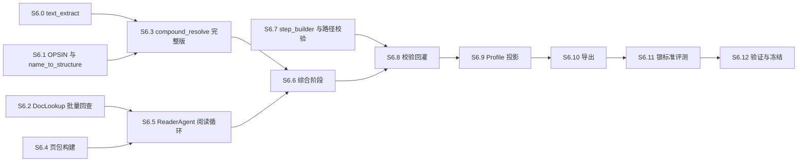

# P6 执行方案：全文理解与产出

> 对应计划：`../phase-06-full-text-understanding.md`
> 周期：D8～D11 ｜ 人员：BE-4（DocLookup、ReaderAgent）、BE-2（OPSIN、归一、step_builder、投影）、BE-3（正文抽取、导出、评测）
> 集成分支：`phase/6-full-text`
> 进入条件：P5 的 FigureReport 与测定已入库（S5.11 完成）；P4 的化合物台账可用

---

## 0. 执行顺序

| 检查点 | 应完成 |
|---|---|
| D8 傍晚 | S6.0、S6.1、S6.4 |
| D9 傍晚 | S6.2、S6.3、S6.7（MCS 与分类） |
| D10 傍晚 | S6.5、S6.6、S6.7（校验） |
| D11 中午 | S6.8、S6.9、S6.10 |
| D11 傍晚 | S6.11、S6.12 |

---

## S6.0 text_extract

**负责 / 时长**：BE-3 / 0.75 天　**前置**：P2、P3

**产出**：`drugpaper/skills/builtin/text_extract/`

**执行**

1. 切块：按章节，以段落为边界，每块 ≤ 3000 tokens，带章节标题；只处理 abstract、results、discussion、conclusion、experimental；introduction 只做正则编号提及。
2. 输出 `TextExtraction`（设计文档 8.9）：`compound_mentions`、`measurements`、`assay_descriptions`、`optimization_statements`，全部带 `char_span`（基于 `text_norm`，由代码映射回 `text_raw`）。
3. 校验 V-E02：`char_span` 内文本必须包含声称的编号和数值，不包含的条目丢弃并计数。
4. 区间展开：`compounds 16−27`。
5. 实验部分的标题段（"名称 (编号)."）标记出来，交给 S6.1。

**验证**：样例摘要中 `26 [UCM-1306, ...]` 产生别名提及；丢弃率记录在报告中。

**完成标志**：样例论文运行完成，结果入库。

---

## S6.1 OPSIN 与 name_to_structure

**负责 / 时长**：BE-2 / 0.5 天　**前置**：P4 的 S4.5

**产出**：`drugpaper/chem/opsin.py`、`drugpaper/skills/builtin/name_to_structure/`、`services/opsin/`（HTTP 模式时）

**执行**

1. 部署方式二选一：`JPype` 内嵌 OPSIN jar，或独立的 OPSIN HTTP 服务（推荐，避免 Worker 进程内启动 JVM）。
2. 切分：实验部分中匹配 `^(?P<name>.+?)\s*\((?P<label>\d+[a-z]?|\([RS]\)-\d+)\)\.` 的段落开头；随后 HRMS / 元素分析行用 `formula.parse_hrms` 解析。
3. OPSIN 解析成功 → `StructureCandidate(source=opsin)`；与 HRMS 分子式比对（考虑 [M+H]+、[M+Na]+），结果写入 `validation.formula_match`。
4. OPSIN 不可用时跳过，不阻断管线。

**验证**：化合物 26 的系统名解析出的结构与 OCSR 一致，分子式 C14H14FNO2S 与 HRMS 一致。

**完成标志**：样例论文实验部分全部"名称 (编号)"对处理完毕，成功率记录在案。

---

## S6.2 DocLookup 批量回查

**负责 / 时长**：BE-4 / 1 天　**前置**：P2 的 grep、P3 的 CapabilityRouter

**产出**：`drugpaper/agents/lookup/{batch.py,fast_path.py,vision.py,cache.py}`

**执行**

1. `lookup(questions: list[LookupQuestion], ctx) -> LookupBatchResult`：
   - **预处理**：抽取编号、图表标签、页码、关键词；归一化问题文本后查缓存（键 `(user_id, document_id, revision, normalized_question)`）；合并重复问题。
   - **快路径**：规则识别"X 出现在哪"（→ grep）、"X 的 Y 值"（→ query_measurements）、"Figure N 的图注"（→ get_node）等模式，直接执行工具并格式化答案，不调用模型。
   - **规划**（任务 `lookup_plan`，1 次）：输入剩余问题和预选工具的 L1 短规格；输出每个问题的动作列表 `[{question_id, tool, args}]`。
   - **执行**：代码并行执行全部动作，结果按问题分组并截断。
   - **作答**（任务 `lookup_answer`，1 次）：逐题回答，给出 `status`、`answer`（≤ 150 字）、`evidence`。
2. `vision.py`：`need_vision` 的问题按页分组，每页 1 次调用（任务 `vision_lookup`），输入 1600 px 页面图 + 该页问题。
3. 约束：只读；子 Agent 不再派子 Agent；`get_figure_report` 不等待；每批 ≤ 8 个问题。
4. 每批一条 RunRecord（`run_type=lookup`），写入 `lookups` 表。

**验证**：6 个问题中 3 个走快路径，模型调用恰好 2 次；重复问题命中缓存；需要看图的问题按页合并。

**完成标志**：测试通过；样例论文上 10 个预设问题的回答正确率记录在案。

---

## S6.3 compound_resolve 完整版

**负责 / 时长**：BE-2 / 0.5 天　**前置**：S6.0、S6.1

**产出**：`drugpaper/facts/resolver.py`（扩充）

**执行**：在 P4 基础版上加入：正文提及与别名（S6.0）；OPSIN 候选；采纳优先级改为"人工 > OPSIN（分子式一致）> OCSR（分子式一致或高置信）> Markush 组装 > OCSR 低置信 > LLM"；角色初判（摘要与结论中反复出现的编号倾向 final，引言中的 hit/lead 描述）。

**完成标志**：样例论文化合物台账完整；26 的采纳结构来源为 OPSIN 且与 OCSR 一致。

---

## S6.4 页包构建

**负责 / 时长**：BE-4 / 0.5 天　**前置**：P5

**产出**：`drugpaper/agents/reader/page_pack.py`

**执行**

1. `build_page_pack(document_id, page) -> PagePack`：本页段落（跨页段落放在起始页）、本页图表的 `FigureDigest`（类型、图注、编号与结构状态、表格要点前 10 行、路线边、自检状态）、本页 T1 事实、脚注。
2. token 估算，超过 7K 时拆成两个阅读单元。
3. 就绪判定：本页所有 FigureAgent 已提交 FigureReport，且本页 T1 已完成。
4. 页面分类：参考文献、致谢 → skip；实验部分 → skim；其余 → read。

**完成标志**：样例论文每页的页包可以生成，并有 token 统计。

---

## S6.5 ReaderAgent 阅读循环

**负责 / 时长**：BE-4 / 1 天　**前置**：S6.2、S6.4

**产出**：`drugpaper/agents/reader/{notes.py,queue.py,graph.py}`、`prompts/skills/reader_page/task.md`

**执行**

1. 阅读图：`next_page` → `classify_page` → `read`（任务 `reader_page`，不带工具，输出 `NoteDelta`）/ `skim`（规则写入台账）/ `skip` → `merge_delta` → `enqueue_questions` → `maybe_flush_lookups` → `compact_if_needed` → `checkpoint` → `next_page`。
2. `merge_delta`：校验每条记录的页码和 `evidence_nodes` 确实存在于本页页包或回查答案中；`from_label`/`to_label` 在化合物台账中存在，不存在的标记"未确认编号"。
3. 待查队列：去重（归一化文本）；`resolved_questions` 中的问题移除；触发条件为队列 ≥ 5、出现 blocking 问题、进入新章节、阅读结束；答案附到下一页的输入。
4. 笔记压缩（代码）：已解决问题折叠；analog 化合物要点折叠；被覆盖的早期叙事折叠为页码指针；仍超限时（尽力项）用 1 次 LLM 摘要压缩。
5. checkpoint：每页写 `reader_notes(document_id, page, version)`。
6. 从第 k 页重读：`reread(document_id, from_page=k)`，从 `reader_notes@page_{k-1}` 恢复。

**验证**：FakeLLM 逐页回放；断点续读；队列自然解答不触发回查；样例论文真实模型运行一遍，笔记人工检查。

**完成标志**：测试通过。

---

## S6.6 综合阶段

**负责 / 时长**：BE-4 / 0.5 天　**前置**：S6.3、S6.5

**产出**：`drugpaper/agents/reader/synthesize.py`、`prompts/skills/reader_synthesize/task.md`

**执行**

1. 综合前把剩余待查问题和综合所需的确认问题合并成 1 批回查。
2. 输入：阅读笔记 + 化合物档案（≤ 12K tokens）+ 路线边；任务 `reader_synthesize`（可开启思考）。
3. 输出 `PathProposal`（设计文档 8.12），`steps[].evidence_node_ids` 优先取自叙事时间线。
4. 提示规则迁移自 `prompt_paper_v2.md` 中"需要理解才能判断"的部分；由代码保证的规则不写进提示。

**完成标志**：样例论文输出 lead、final、主路线、策略、构效关系、标签、总结。

---

## S6.7 step_builder 与路径校验

**负责 / 时长**：BE-2 / 1 天　**前置**：P4 的 chem 核心

**产出**：`drugpaper/chem/{diff.py,change_classifier.py,ring_lexicon.py}`、`config/ring_lexicon.yaml`、`drugpaper/validators/path.py`、`drugpaper/facts/paths.py`

**执行**

1. `diff.fragment_changes(start, end)`：`rdFMCS.FindMCS(ringMatchesRingOnly=True, completeRingsOnly=True, timeout=10)`；差异原子按连通性聚成区域；每个区域扩 1 个键的上下文；`MolFragmentToSmiles` 生成片段，并记录原子索引；尝试 `rootedAtAtom` 输出以满足字符串子串。
2. `change_classifier.classify(start, end, regions)`：环替换（比较变化环的原子组成）、N-去烷基化（分子式差 CnH2n 且被删原子连在 N 上）、卤代、甲基化、羟基化、环化/开环、链长变化、立体变化。
3. `ring_lexicon.yaml`：中英文环名与环大小、杂原子组成，例如 pyridine/吡啶/pyridin-/pyridyl → 6 元环、1 个 N。
4. `validators/path.py`：V-P01～V-P08（设计文档 11.2）。
5. 多处修改拆分（尽力）：按"环系变化优先"依次应用区域变化，生成虚拟中间体并 sanitize；无法拆分时保留一步并告警。

**验证**：用构造的分子对测试每种变化类型；V-P05、V-P06 的反例测试。

**完成标志**：测试通过。

---

## S6.8 校验回灌

**负责 / 时长**：BE-4、BE-2 / 0.25 天　**前置**：S6.6、S6.7

**产出**：`drugpaper/orchestration/pipeline_graph.py`（扩充）

**执行**：主图加入 `reader_read` → `path_reason`（综合）→ `step_builder` → 校验失败且尝试次数 < 3 时带 `path_feedback` 回到综合（综合前可以再做 1 批回查）→ 通过或次数用尽后进入投影；失败步骤标记 `needs_review`。

**完成标志**：构造一个错误声明的步骤，能看到回灌与修正。

---

## S6.9 Profile 投影

**负责 / 时长**：BE-2 / 0.5 天　**前置**：S6.8

**产出**：`drugpaper/profiles/{projector.py,drug_optimization_v1/}`、`drugpaper/validators/projection.py`

**执行**

1. `profile.yaml` 按设计文档 14.1 的字段来源定义；`output.schema.json` 为用户给定结构（以 `先导化合物分子信息` 为准，`end` 为对象）。
2. `export_smiles` 规则、`comparison_builder`（按标签映射指标类别，3～8 项同名指标）、`metrics_builder`（以最终产物为主体，按物种与条件排序取值，其余进审计版）。
3. V-J01～V-J05。
4. 审计版：同结构，每个字段附 `evidence` 与 `source_ids`。

**完成标志**：样例论文交付 JSON 通过 V-J 全部校验。

---

## S6.10 导出

**负责 / 时长**：BE-3 / 0.75 天　**前置**：S6.9

**产出**：`drugpaper/exporters/*`、`POST /documents/{id}/exports`、`GET /exports/{id}/download`

**执行**：按设计文档 14.2 的文件清单生成导出包。Corpus Markdown 中图像描述的位置与现有 `insert_image_info` 一致（紧跟图片语句之后），描述由结构化结果按模板生成（`figure_describe` 关闭时）。`manifest.json` 记录全部组件版本、模型、校验摘要与告警。

**完成标志**：导出包完整；Corpus Markdown 可以直接喂给现有 `prompt_paper_v2.md`。

---

## S6.11 银标准评测

**负责 / 时长**：BE-3 / 0.25 天　**前置**：S6.10

**产出**：`drugpaper/evals/silver.py`、`samples/outputs/phase-6/silver_report.md`

**执行**：读取 `tests/fixtures/silver/` 中的 `gemini_json_backup_*.json`，与本系统输出做字段级对比：最终产物与先导化合物的 InChIKey 匹配、标签重合度、指标召回、steps 数量与串联性。输出报告。

**完成标志**：10 篇论文的对比报告生成。

---

## S6.12 验证与冻结

**负责 / 时长**：BE-4 / 0.25 天　**前置**：S6.11

**产出**：`scripts/verify_phase_6.py`、`docs/interfaces/full-text.md`

**执行**：`verify_phase_6.py` 依次执行：样例论文全流程 → 交付 JSON 与 V-J 校验 → lead/final 检查（final 应为 26）→ 证据可回跳检查（每个非 null 字段都能解析到节点）→ 调用数统计与预算对比 → 银标准报告。

**完成标志**：阶段计划第 7 节验收清单全部勾选；冻结 `PagePack`、`NoteDelta`、`LookupBatchResult`、`PathProposal`、`Step`、Profile 格式、导出格式；打标签 `p6-done`。

## 2026-10-05 执行记录

S6.0/S6.4 基础代码已交付，公开 SkillTool、原文证据、缓存、页包就绪和命令入口可运行。正文产物存 Artifact/Run；正式测定与化合物台账融合属于 S6.3。唯一原文引文定位作为偏移修复补充，仍标 needs_review。

S6.1～S6.3、S6.5～S6.12 继续待办；未打 p6-done，未宣称 P5 真正内容验收通过。接口与限制见 `../../interfaces/full-text.md`，本次最终验证证据见 `samples/outputs/phase-6/20261005-foundation-final/`。

### 2026-10-05 S6.1/S6.3 开发接续

- 接入可选 OPSIN JSON HTTP Tool、公开 name_to_structure、同段 HRMS/加合离子组成校验、原始结构与标签原子入库，复核状态和故障重试保留；没有部署正式 OPSIN 服务。
- compound_resolve 合并当前正文提及/别名/OPSIN，完成优先级、公式/别名冲突、角色初判证据、人工锁与过期材料保护。正文测定正式映射尚未接入。
- 样例四条名称已真实处理，3条成功、26的OCR名称含·而失败；样例无HRMS，全部候选未认证。设计名称S位点失败另存。乙醇真实成功和设计26受控回放通过，未满足样例26的 OPSIN/HRMS 内容验收完成标志。
- 测试、复现命令和报告见 ../../interfaces/full-text.md 与 samples/outputs/phase-6/20261005-chemistry/completion.md。S6.2、S6.5～S6.12继续待办，不勾选整阶段验收、不打p6-done。

### 2026-10-05 S6.0～S6.12 逐项开发交付

本表为当前状态，上面的起步记录保留历史。全部开发模块已接入；“开发验证通过”不等于真实文献内容验收通过。

| 项目 | 开发交付与验证 | 真实验收状态 |
|---|---|---|
| S6.0 text_extract | 已接入公开Skill、长段切块、证据/V-E02、编号别名、缓存和事务；60节点样例回放通过 | 全文真实模型召回率待人工核验 |
| S6.1 OPSIN/name_to_structure | 独立JVM HTTP服务、Compose部署件、原始名称/结构、HRMS组成与Skill入库链路；真实乙醇与N-methylaniline服务测试通过 | 26的OCR名称及设计S位点名称失败；样例无HRMS；未部署业务服务 |
| S6.2 DocLookup/VisionLookup | 批量≤8题、快路径、一次规划/作答、只读白名单、按页视觉合并、缓存/Run；6题2调用与10题样例定位验证 | 十题限定图注/别名，不认证通用推理和化学正确率 |
| S6.3 compound_resolve | 正文/名称/视觉融合、优先级、冲突、角色初判、人工锁；补齐测定/Assay幂等映射 | 26采纳OPSIN并与OCSR一致的实文条件未满足 |
| S6.4 PagePack | 章节路径、图表/T1摘要、7000token单元、read/skim/skip、pending与复核状态 | P5失败/缺失材料仍阻断相应页面 |
| S6.5 ReaderAgent | 无工具逐页模型、NoteDelta校验、问题自然解答/批量队列、8000token代码压缩、每页版本、断点恢复/第k页重读；SQLite与PG测试通过 | 真实全文笔记人工检查待P5就绪；尽力项LLM压缩未启用 |
| S6.6 综合 | 一批确认、12000token档案、PathProposal及lead/final/主路线/策略/SAR/标签/总结、证据；受控完整结果通过 | 受控final=26不替代真实论文角色识别 |
| S6.7 step_builder/V-P | 完整环MCS、片段/原子索引、九类变化、环名、V-P01～08；构造分子对重建与反例通过 | 多区域尽力拆为虚拟中间体/split_steps审计候选，原步骤保持needs_review |
| S6.8 校验回灌 | LangGraph最多三次综合，反馈和每次路径保存；错误声明修正与次数上限测试通过 | 次数用尽的未通过项保留复核 |
| S6.9 Profile | 固定旧用户JSON，数字steps/对象end/字符串null、原始E-SMILES、最终产物条件筛选、同形审计；V-J01～05/V-E01通过 | 真实样例完整交付受P5/化学证据限制 |
| S6.10 导出 | JSON/审计JSON/Corpus及审计Markdown/IR/化合物/长表CSV/chunks/图像/曲线/manifest、私有ZIP与下载API；受控12文件及哈希通过 | review随包保留，不自动认证内容 |
| S6.11 银标准 | 已收录10份真实历史完整JSON及路径/SHA；字段/InChIKey/指标/标签/步骤比较、缺失预测非零退出，报告已生成 | 独立系统预测0/10，不能报告实际识别率或实文调用中位数 |
| S6.12 验证/冻结 | 完整验证入口、API/CLI/Celery、0008迁移、11模型/Profile/OpenAPI及哈希冻结；877测试、Ruff和mypy通过 | 实文验收清单保留未勾选，未打p6-done；目录未初始化Git |

证据：`samples/outputs/phase-6/20261005-full-text/completion.md`、`tests-all-final.xml`、`verify-final/controlled-workflow/report.json`。首次全量875通过/2失败来自旧迁移表名清单未更新，修复后877全部通过；历史报告保留。正式业务数据库未迁移，常驻服务未重启。

最终补强：全组件指纹变化阻断旧回查/阅读/结果复用；导出查询先物化，防止读取模型清单后耗尽迭代器而丢失调用统计。增加Reader及全文模型次数入包断言，24项全文专项最终复测通过（tests-export-stats-final.xml），受控导出重新生成。
