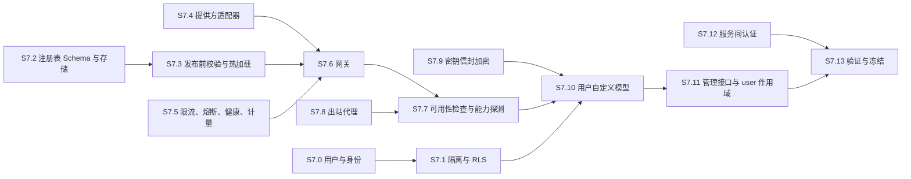

# P7 执行方案：模型管理与用户

> 对应计划：`../phase-07-models-and-users.md`
> 周期：D5～D10 ｜ 人员：BE-1（主）、FE-2（登录页）
> 集成分支：`phase/7-models-users`
> 进入条件：P2 冻结；P3 的 S3.7（任务名调用）完成

---

## 0. 执行顺序

| 检查点 | 应完成 |
|---|---|
| D5 傍晚 | S7.0、S7.2 |
| D6 傍晚 | S7.1、S7.3、S7.4 |
| D7 傍晚 | S7.5、S7.6 |
| D8 傍晚 | S7.7、S7.8 |
| D9 傍晚 | S7.9、S7.10 |
| D10 傍晚 | S7.11、S7.12、S7.13 |

---

## S7.0 用户与身份

**负责 / 时长**：BE-1 / 0.5 天（FE-2 同步做登录页 0.5 天）　**前置**：P2

**产出**：`drugpaper/auth/{users.py,api_keys.py,tokens.py,roles.py,middleware.py}`、迁移 `0006_users.py`、`drugpaper/api/auth.py`

**执行**

1. `users(id, name, api_key_hash, role, quota, status, created_at)`；API Key 只存 `argon2` 哈希，生成时只展示一次。
2. `POST /auth/login`（API Key 换取短期 JWT，默认 12 小时）；`GET /auth/me`。
3. 中间件：`Authorization: Bearer <jwt>` 或 `X-API-Key`；解析出 `user_id` 与 `role`，放入请求上下文。
4. 角色：`user`、`admin`；`/admin/*` 需要 `admin`。
5. CLI：`drugpaper users create --name xx --role admin` 输出一次性 Key。

**完成标志**：未带凭证的请求返回 401；普通用户访问 `/admin/*` 返回 403。

---

## S7.1 隔离与 RLS

**负责 / 时长**：BE-1 / 0.75 天　**前置**：S7.0

**产出**：迁移 `0007_rls.py`、`drugpaper/persistence/db.py`（会话上下文）、`tests/integration/test_isolation.py`

**执行**

1. 所有业务表启用 RLS：`ALTER TABLE x ENABLE ROW LEVEL SECURITY; CREATE POLICY x_isolation ON x USING (user_id = current_setting('app.current_user_id'));`。下游表没有 `user_id` 的，通过 `document_id` 关联策略，或补一个冗余的 `user_id` 列（推荐补列，查询简单）。
2. 应用连接使用非超级用户角色，确保 RLS 生效；迁移使用单独的管理角色。
3. 会话创建时 `SET LOCAL app.current_user_id`；后台任务从任务参数中取 `user_id` 设置。
4. API 层归属校验：不存在或不属于当前用户的资源一律 404。
5. BlobStore 路径加 `user_id` 前缀（P2 已预留）；模型缓存键加 `user_id`；grep 缓存按 `(user_id, document_id)`。
6. 历史数据（`default` 用户）迁移为首个管理员用户所有。

**验证**：隔离测试覆盖文档、节点、Artifact、Blob、检索、Skill、运行记录；另写一个"故意漏写过滤条件"的查询，确认 RLS 仍然只返回本用户数据。

**完成标志**：测试通过。

---

## S7.2 注册表 Schema 与存储

**负责 / 时长**：BE-1 / 0.75 天　**前置**：P3 的 S3.7

**产出**：`drugpaper/models_registry/{schema.py,store.py,io.py}`、迁移 `0008_model_registry.py`

**执行**

1. Pydantic 模型：`ProviderCfg`、`ModelCfg`（capabilities、limits、concurrency、cost、family、strength）、`PoolCfg`、`StageCfg`（pool 或 model、requires、min_strength_of）、`TaskCfg`、`RegistryCfg`（schema_version + 以上五层）。
2. 表：`model_registry_versions`（scope、owner_user_id、status、config JSONB、base_version、test_report、eval_report、changed_by、published_at）、`model_secrets`、`model_config_audit`、`user_model_settings`、`document_model_snapshot`、`model_calls`（按月分区）。
3. `store.py`：`current(scope, owner)`、`create_draft(from_version)`、`patch_draft(path, value)`、`publish(draft)`、`rollback(version)`、`history()`；每个操作写审计。
4. `io.py`：YAML 导入（首次启动时把 `config/models.yaml` 导入为 system 第 1 版）、导出。

**完成标志**：导入 → 草稿修改 → 发布 → 回滚的往返测试通过。

---

## S7.3 发布前校验与热加载

**负责 / 时长**：BE-1 / 0.25 天　**前置**：S7.2

**产出**：`drugpaper/models_registry/validate.py`

**执行**

- 校验：引用完整；阶段 `requires` 被候选模型满足；任务参数不超过模型限制；`self_check` 强度不低于 `structure`；`vlm_light` 池可以包含强模型，`vlm_strong` 池不能包含弱模型。
- 发布后发布 Redis 消息 `models:changed {scope, owner, version}`；各进程重新加载对应配置；进行中的调用不受影响。

**完成标志**：每条校验规则有反例测试。

---

## S7.4 提供方适配器

**负责 / 时长**：BE-1 / 0.5 天　**前置**：P1 的 S1.3

**产出**：`drugpaper/gateway/providers/{base.py,openai_compatible.py}`

**执行**

1. 从 P1 的 `OpenAICompatClient` 重构：适配器只负责"内部请求 ↔ 提供方请求"的转换，重试与限流移到网关。
2. 结构化输出降级链：`json_schema → guided_json（vLLM/sglang 的 extra_body）→ json_object + 校验 → prompt_only + json_repair + 校验`；按模型 `capabilities.structured_output` 选择起点。
3. 思考开关：按 `capabilities.thinking.toggle` 注入。
4. grounding 坐标：按 `coord_format`（`rel_1000`、`abs_pixel`、`norm_0_1`）统一换算成归一化 BBox；换算函数放在适配器之外，供 Skill 调用。
5. 错误映射：HTTP 状态码与提供方错误体 → 统一异常。

**完成标志**：P1 的客户端测试迁移到适配器后全部通过。

---

## S7.5 限流、熔断、健康、计量

**负责 / 时长**：BE-1 / 0.5 天　**前置**：S7.2

**产出**：`drugpaper/gateway/{limiter.py,health.py,meter.py}`

**执行**

1. `limiter`：Redis 分布式信号量（`ZSET` + 租约超时，防止进程崩溃后槽位泄漏）。平台模型按 `model_name@provider` 计数；用户模型按 `(user_id, model)` 计数。每个平台模型预留 25% 槽位给 `interactive` 优先级。
2. `health`：连续 5 次失败或 30 s 内错误率 > 50% 时熔断 30 s；半开期间只放 1 个探测请求；每 15 s 做一次后台健康检查。
3. `meter`：每次调用写 `model_calls`（task、stage、model、provider、config_scope、billing_owner、tokens、image_count、latency、status、cache_hit、fallback_from）；按用户累计当日平台用量，与 `users.quota` 比较。

**完成标志**：并发压测下信号量不超发；熔断与恢复有测试。

---

## S7.6 网关

**负责 / 时长**：BE-1 / 0.5 天　**前置**：S7.3、S7.4、S7.5

**产出**：`drugpaper/gateway/gateway.py`、`drugpaper/models_registry/resolve.py`

**执行**

1. `resolve(task, ctx)`：读取文档的配置快照（`document_model_snapshot`，文档开始处理时写入）→ 平台任务 → 阶段 → 候选模型链；用户配置覆盖逻辑在 S7.10 接入。
2. `ModelGateway.call(task, request, ctx)`：按设计文档 18.2.3 的伪代码；主备回退（`vlm_strong` 不回退到弱模型）；缓存；计量；配额检查。
3. 替换 P3 的 `task_router`：`ModelClient` 的实现改为网关，调用方不变。
4. 所有已有调用方（Skill、Agent、DocLookup、Reader）必须传 `CallContext(user_id, document_id, priority, run_id)`；缺失时报错。

**完成标志**：P1～P6 的测试在网关下全部通过；`model_calls` 有数据。

---

## S7.7 可用性检查与能力探测

**负责 / 时长**：BE-1 / 0.5 天　**前置**：S7.6、S7.8

**产出**：`drugpaper/models_registry/probe.py`、`tests/fixtures/probe/`（测试图：固定文字图、已知分子位置的结构图）

**执行**

1. `check_availability(model_cfg, secret)`，任一步失败即返回失败原因：
   - 地址规则（调用 S7.8 的判定函数）；
   - 连通与 TLS；
   - 认证（401/403）；
   - 模型名（`GET /models` 列表；接口不存在时发 1 个最小请求，看是否报模型不存在）；
   - 最小推理（`max_tokens=8` 的文本请求，在超时内返回）。
2. `probe_capabilities(model_cfg, secret)`：
   - 视觉：固定文字图，要求读出文字；
   - 结构化输出：依次尝试 json_schema、guided_json、json_object；
   - grounding：已知分子位置的图，要求返回框，与标准框比对，判断 `coord_format`；
   - 思考开关：检查输出中是否仍有思考内容；
   - 延迟：以上请求的中位数。
3. 结果写入 `test_report`，并回填为 `capabilities` 建议值。

**完成标志**：对平台现有模型探测结果正确；错误密钥、错误模型名、不通的地址都能给出明确原因。

---

## S7.8 出站代理

**负责 / 时长**：BE-1 / 0.5 天　**前置**：无

**产出**：`drugpaper/egress/{rules.py,proxy.py}`、`tests/unit/test_egress.py`

**执行**

1. `rules.py`：`is_allowed(url, resolved_ip) -> (bool, reason)`：
   - 回环（127.0.0.0/8、::1）、链路本地（169.254.0.0/16、fe80::/10）、云元数据（169.254.169.254、fd00:ec2::254）始终拒绝；
   - 平台保留地址：从 `services.yaml`、平台注册表的 provider、`DATABASE_URL`、`REDIS_URL` 自动收集主机与端口，加上管理员追加的网段，拒绝；
   - 私有网段允许（可由管理员关闭）；公网允许；
   - 公网仅 https，私有网段允许 http。
2. `proxy.py`：用户模型的请求通过一个自定义 `httpx` transport 发出：连接前解析 DNS，对解析出的每个 IP 调用 `is_allowed`，只连接通过的 IP（固定 IP 连接，防止 DNS 重绑定），并设置 SNI/Host；`follow_redirects=False`；响应大小上限 2 MB；连接与读取超时。
3. 若部署上更倾向独立代理（Squid/Envoy），由 `rules.py` 生成 ACL 配置，行为一致。

**验证**：阶段计划 6 节的 SSRF 用例全部通过。

**完成标志**：测试通过。

---

## S7.9 密钥信封加密

**负责 / 时长**：BE-1 / 0.25 天　**前置**：S7.2

**产出**：`drugpaper/secrets/envelope.py`

**执行**

- 主密钥 `MODEL_SECRET_MASTER_KEY`（32 字节，环境变量）；每个用户一个数据密钥（DEK），AES-GCM 加密后存 `model_secrets.wrapped_dek`；密钥明文用 DEK 加密存 `ciphertext`。
- `put_secret(scope, owner, provider, plaintext)`、`get_secret(...)`（只在网关内调用）、`hint()`（末 4 位）。
- 日志过滤器：拦截形如密钥的字符串（`sk-`、长度 ≥ 20 的 base64 等），替换为 `***`。

**完成标志**：接口、日志、RunRecord、错误信息、缓存键中都找不到密钥明文（自动化扫描测试）。

---

## S7.10 用户自定义模型

**负责 / 时长**：BE-1 / 0.75 天　**前置**：S7.1、S7.7、S7.9

**产出**：`drugpaper/api/me_models.py`、`drugpaper/models_registry/resolve.py`（扩充）、`drugpaper/orchestration/waiting.py`

**执行**

1. `/me/models` 接口（设计文档 18.2.5）。添加或修改模型、provider、密钥时同步执行 S7.7 的可用性检查，失败返回 422 和原因，不保存；通过后自动执行能力探测并回填。
2. 阶段绑定：`PUT /me/models/stages/{stage}`，校验模型能力满足阶段 `requires`。
3. 解析扩充：按设计文档 18.2.8 的伪代码合并用户配置；用户可改的任务参数白名单（温度、超时，且不超过平台上限的 2 倍）。
4. 文档级快照：文档开始处理时写 `document_model_snapshot(system_version, user_version)`。
5. 回退策略：`pause`（默认）→ 文档状态 `waiting_user_model`，记录失败阶段与原因，通知用户；用户修复后 `POST /documents/{id}:resume` 从 checkpoint 继续；`fail`；`fallback_to_platform`（需管理员策略允许）。
6. 每日复检任务：对所有已保存的用户模型执行可用性检查，失败时标红并通知。

**验证**：阶段计划 6 节的用户模型用例。

**完成标志**：测试通过。

---

## S7.11 管理接口与 user 作用域

**负责 / 时长**：BE-1 / 0.5 天　**前置**：S7.10

**产出**：`drugpaper/api/admin_models.py`、`drugpaper/skills/registry.py`（启用 user 作用域）

**执行**

1. `/admin/models/*` 全部接口（设计文档 18.2.5）；自定义模型策略（开关、provider 类型、保留地址、私网开关、并发与超时上限、是否允许回退平台）。
2. Skill 的 `user` 作用域：`skills/users/{user_id}/` 目录、注册表 `owner_user_id`、能力索引按用户缓存。

**完成标志**：管理员通过接口完成"替换平台阶段模型 → 校验 → 测试 → 发布 → 回滚"。

---

## S7.12 服务间认证

**负责 / 时长**：BE-1 / 0.25 天　**前置**：无

**产出**：各内部服务的认证中间件；`config/services.yaml` 的令牌配置

**执行**：MinerU（在其前面加一层反向代理校验令牌，或在调用侧所在网段做访问控制）、MolDet、MolParser、OPSIN、平台推理服务都要求 `X-Service-Token`；数据库和 Redis 设置口令并限制来源地址。

**完成标志**：不带令牌访问这些服务全部被拒。

---

## S7.13 验证与冻结

**负责 / 时长**：BE-1 / 0.25 天　**前置**：S7.11、S7.12

**产出**：`scripts/verify_phase_7.py`、`docs/interfaces/models-and-users.md`

**执行**：`verify_phase_7.py` 依次执行：两个用户隔离测试 → 管理员替换平台模型并回滚 → 用户添加错误与正确的自有模型 → hybrid 模式处理一篇文档并检查 `billing_owner` → 回退策略 pause 与续跑 → SSRF 用例 → 密钥扫描 → 输出报告。

**完成标志**：阶段计划第 7 节验收清单全部勾选；冻结注册表 Schema、`/admin/models/*`、`/me/models/*`、`model_calls` 字段；打标签 `p7-done`。
