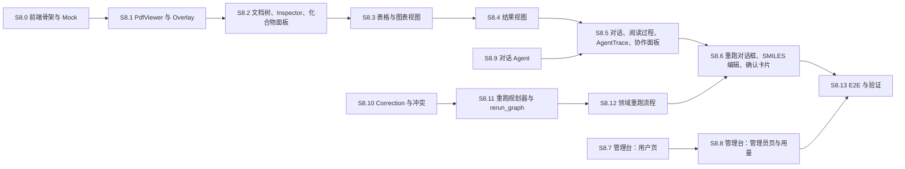

# P8 执行方案：交互、对话与细粒度重跑

> 2026-11-20：本期按文末「新增执行范围」实施；原 S8.0–S8.13 是完整 P8 长期方案，不将其中单元格/关联编辑、父子图操作自动纳入本期。新增条目的基础交付见文末最新记录，不改变历史完整阶段验收结论。

> 对应计划：`../phase-08-interaction-ui-rerun.md`
> 周期：D3～D14 ｜ 人员：FE-1（工作台）、FE-2（管理台）、BE-4（对话 Agent）、BE-1（纠错与重跑）、BE-2 / BE-3（各自领域的重跑流程）
> 集成分支：`phase/8-interaction`
> 进入条件：前端从 D3 起用 Mock（P2 的 OpenAPI）开发；后端各部分按依赖逐步接入

---

## 0. 执行顺序

| 检查点 | 应完成 |
|---|---|
| D3 傍晚 | S8.0 |
| D4 傍晚 | S8.1 |
| D6 傍晚 | S8.2 |
| D8 傍晚 | S8.3 |
| D9 傍晚 | S8.4 |
| D10 傍晚 | S8.9 |
| D11 傍晚 | S8.5、S8.10、S8.7（用户页主体） |
| D12 傍晚 | S8.11、S8.8 |
| D13 傍晚 | S8.12、S8.6 |
| D14 傍晚 | S8.13 |

---

## S8.0 前端骨架与 Mock

**负责 / 时长**：FE-1 / 0.5 天　**前置**：P2 的 OpenAPI 草案

**产出**：`web/`（Vite + React 18 + TypeScript）、`web/src/api/`（由 OpenAPI 生成的客户端）、`web/mock/`

**执行**

1. 依赖：`pdfjs-dist`、`@tanstack/react-query`、`zustand`、`@rdkit/rdkit`、UI 组件库（团队熟悉的一套即可）、`openapi-typescript`、`msw`（Mock）。
2. 路由：`/login`、`/documents`、`/documents/:id`（工作台）、`/settings/models`、`/admin/models`。
3. SSE 客户端：订阅 `/documents/{id}/events`，按事件类型让对应查询失效。
4. Mock：用样例论文的 IR 快照、P5/P6 的样例输出生成静态 Mock 数据。

**完成标志**：`npm run dev` 能打开工作台空壳；接口类型由 OpenAPI 自动生成。

---

## S8.1 PdfViewer 与 Overlay

**负责 / 时长**：FE-1 / 1.5 天　**前置**：S8.0

**产出**：`web/src/pdf-viewer/`

**执行**

1. pdf.js 渲染，按页虚拟滚动（只渲染可视页及前后各 1 页）。
2. Overlay（SVG）：按 `pages/{p}/nodes` 绘制节点 regions，颜色按节点类型区分；图层开关（段落、图表、分子、图注）。
3. 交互：悬停高亮；点击吸附到节点（只能选中已解析的节点）；选中状态进入 Zustand。
4. 证据高亮：给定 `EvidenceRef`（节点 + 可选行级 region 或单元格 region），滚动到对应页并高亮。
5. 缩放时按归一化坐标换算，不重新请求数据。

**完成标志**：样例论文 15 页流畅滚动；点击任意节点可选中；证据高亮位置准确。

---

## S8.2 文档树、Inspector、化合物面板

**负责 / 时长**：FE-1 / 1 天　**前置**：S8.1

**产出**：`web/src/{doc-tree,inspector,compound-panel}/`

**执行**

- 文档树：懒加载子节点；点击跳转并选中。
- Inspector：节点全文、子节点、Artifact 摘要与历史版本、质量标记、可用 Skill 列表（`/skills/catalog` 按 accepts 过滤）。
- 化合物面板：RDKit.js 渲染结构；编号、别名、角色、结构来源徽标（OCSR、OPSIN、人工、组装）、冲突标记；点击列出所有出现位置并可跳转。

**完成标志**：切换到真实 P4 接口后，化合物 26 的结构与出现位置正确显示。

---

## S8.3 表格与图表视图

**负责 / 时长**：FE-1 / 1 天　**前置**：S8.2；P5 的 table_grid 与 chart_dataset 接口

**产出**：`web/src/{table-view,chart-view}/`

**执行**

- TableView：抽取的网格与原图并排；悬停单元格时同步高亮原图区域（有单元格 bbox 时）；单元格可编辑（提交 Correction）；显示自检结论（correct / incorrect / unsure / unchecked）。
- ChartView：原图 / 叠加图切换；数据表可编辑；显示坐标轴标定参数与残差。

**完成标志**：Table 3 与样例图表完整展示；单元格编辑生成 Correction 请求（后端就绪前走 Mock）。

---

## S8.4 结果视图

**负责 / 时长**：FE-1 / 1 天　**前置**：S8.3；P6 的 profile result 接口

**产出**：`web/src/result-view/`

**执行**：按用户 JSON 结构渲染各字段；每个字段旁有证据标签，点击跳转；steps 以"起始结构 → 结束结构"卡片展示，用 RDKit.js 高亮变化原子（使用 `fragments[].original_atoms`）；字段级 stale / needs_review 标记；审计视图切换。

**完成标志**：样例论文的交付 JSON 全部字段可视化，证据可回跳。

---

## S8.5 对话、阅读过程、AgentTrace、协作面板

**负责 / 时长**：FE-1 / 1.5 天　**前置**：S8.4、S8.9

**产出**：`web/src/{chat-panel,reading-view,agent-trace,collaboration-panel}/`

**执行**

- ChatPanel：SSE 流式（token、tool_call、citation、confirm_required、done）；引用编号可点击；确认卡片（修改前后对比 + 重跑计划预览）。
- 阅读过程视图：按页展示笔记增量、新化合物、叙事事件、疑问；回查以"问题 → 答案 → 证据"卡片展示。
- AgentTrace：按图展示分类、Skill 链、L1 告警、L2 逐项结论、补救动作与理由、调用计数。
- 协作面板：所有图的 FigureReport 状态、Coordinator 的定向问题与答案、降级级别、主路线相关图的待确认项。

**完成标志**：真实接口下全部可用。

---

## S8.6 重跑对话框、SMILES 编辑、确认卡片

**负责 / 时长**：FE-1 / 0.75 天　**前置**：S8.5、S8.11

**产出**：`web/src/{rerun-dialog,smiles-editor}/`

**执行**

- RerunDialog：选择 Skill（或"整张图重新理解"、"补做复核"、"从第 k 页重读"），可选模型参数；先调用 `dry_run` 展示影响范围（将调用的模型次数、自动更新的字段、会变为 stale 的字段），确认后执行并显示进度。
- SmilesEditor：输入框 + RDKit.js 实时渲染与合法性校验；提交后走 Correction。
- 分子框微调（尽力）：拖动 4 个角，只能在父节点范围内。

**完成标志**：设计文档 13.4 的场景都能从 UI 发起。

---

## S8.7 管理台：用户"模型设置"页

**负责 / 时长**：FE-2 / 1.5 天　**前置**：P7 的 `/me/models`（D9 起真实接口）

**产出**：`web/src/model-console/user-settings/`

**执行**

- 模式选择（platform / custom / hybrid）；首次选择自定义时的数据外发确认。
- 我的提供方：添加、编辑、删除；密钥只写，显示末 4 位；保存时显示可用性检查的逐项结果，失败时显示原因，不关闭表单。
- 我的模型：添加时自动探测能力，结果以勾选项展示。
- 阶段绑定：流水线图展示 12 个推理阶段；不满足能力要求的模型置灰并提示原因。
- 回退策略、版本历史与回滚、用量（按阶段、模型，区分平台配额与我的 API）。

**完成标志**：P7 的用户模型验收场景可以在页面上完成。

---

## S8.8 管理台：管理员页与用量

**负责 / 时长**：FE-2 / 1 天　**前置**：S8.7、P7 的 `/admin/models`

**产出**：`web/src/model-console/admin/`

**执行**：平台提供方、模型、模型池（拖拽排序）、阶段绑定、任务参数；草稿差异对比、校验与测试结果、发布、回滚、审计记录；自定义模型策略；健康与用量看板（并发、延迟、错误率、熔断状态、按阶段 / 模型 / 用户 / billing_owner 统计）。

**完成标志**：管理员可以在页面上完成"替换平台阶段模型 → 测试 → 发布 → 回滚"。

---

## S8.9 对话 Agent

**负责 / 时长**：BE-4 / 1 天　**前置**：P3 的 DisclosureToolset、P6 的 DocLookup

**产出**：`drugpaper/agents/chat/{graph.py,prompts/}`、`drugpaper/api/chat.py`、迁移 `0009_chat.py`

**执行**

1. 复用 `AgentRuntime`：`AgentConfig(name="chat", toolset=DisclosureToolset(core=[grep, search, get_node, get_compound, query_measurements]), validators=[CitationValidator], budget=...)`。
2. 上下文：文档概要（约 1K tokens，常驻）、UI 焦点节点、最近 6 轮完整历史 + 更早的摘要；按问题与焦点预选能力（L0，高相关附 L1）。
3. 写入类工具 `propose_correction` / `request_rerun`：调用后生成重跑计划（`dry_run`），通过 LangGraph `interrupt` 暂停，SSE 推送 `confirm_required`；`POST /chat/sessions/{sid}/confirmations/{cid}` 恢复。
4. 会话持久化：`chat_sessions`、`chat_messages`；Postgres checkpointer 的 `thread_id = chat_session_id`。
5. SSE 事件：`token`、`tool_call`、`citation`、`confirm_required`、`done`、`error`。

**验证**："化合物 26 的 hERG 抑制率是多少" → 21%（10 μM），引用 Table 3 单元格；需要图表数据的问题触发 `load_capability(get_chart_data)`。

**完成标志**：测试通过。

---

## S8.10 Correction 与冲突

**负责 / 时长**：BE-1 / 0.75 天　**前置**：P3 的 Artifact 体系

**产出**：`drugpaper/corrections/{models.py,service.py,conflicts.py}`、`drugpaper/api/corrections.py`、迁移 `0010_corrections.py`

**执行**

1. Correction 的 `target_type` 与 `action` 按设计文档 6.10；默认 `set_value` 同时锁定。
2. 锁定保护接入 SkillRuntime 的提交流程（P3 已预留接口）：自动结果与锁定值不同时，保留锁定值，生成 Conflict。
3. 撤销：`:revert` 解锁并恢复前值，同样走重跑规划。
4. 冲突：列表、详情、解决（采纳自动值、保留锁定值、手工输入）。

**完成标志**：锁定保护测试通过（自动流程产生不同结果时不覆盖）。

---

## S8.11 重跑规划器与 rerun_graph

**负责 / 时长**：BE-1 / 1 天　**前置**：S8.10

**产出**：`drugpaper/rerun/{planner.py,graph.py}`、`drugpaper/api/reruns.py`

**执行**

1. `plan_rerun(trigger)`：确定种子 Work Unit → 沿 `artifact_dependencies` 找下游 → 按 manifest 的 `deterministic` 标记分为"自动执行"和"标记 stale" → 预估模型调用数与冲突 → 返回 `RerunPlan`。
2. `rerun_graph`：在 `interactive` 队列执行种子 Work Unit，再按拓扑顺序执行确定性下游；完成后推送 `rerun.completed`（附字段级变化摘要）。
3. 特殊入口：`figure_agent:<node>`（full / review 模式）、`reader_agent:<doc>` 的 `from_page`、`path_reason:<doc>`。
4. `compound_resolve` 增量执行（只重算受影响的化合物）。

**验证**：设计文档 13.4 的全部场景，逐一检查"立即执行、自动更新、标记 stale"与预览一致。

**完成标志**：测试通过。

---

## S8.12 领域重跑流程

**负责 / 时长**：BE-2、BE-3 / 0.75 天　**前置**：S8.11

**执行**

- BE-2：手动 SMILES（RDKit 校验 → Correction(structure, lock) → 规划 → 化合物 → 步骤片段 → 投影）；单分子重识别；分子框调整（重裁剪 → OCSR）；编号绑定修正。
- BE-3：表格重抽取（结构化 + 自检，锁定单元格保留）；单元格修正；图表重数字化。

**完成标志**：各场景在后端测试中通过，依赖记录可查。

---

## S8.13 E2E 与验证

**负责 / 时长**：FE-1 / 0.5 天　**前置**：S8.6、S8.8、S8.12

**产出**：`web/e2e/`（Playwright）、`scripts/verify_phase_8.py`

**执行**

1. E2E 核心路径：登录 → 上传 → 等待完成 → 工作台浏览 → 点击证据高亮 → 对话提问 → 对话中纠错并确认 → 结果视图字段更新 → 重跑一张图表 → 模型设置页添加错误 / 正确的自有模型。
2. `verify_phase_8.py`：后端重跑场景矩阵 + 对话用例 + 管理台接口用例。

**完成标志**：阶段计划第 7 节验收清单全部勾选；打标签 `p8-done`。

## 2026-11-20 新增执行范围：全过程开发调试（待开发）

依据：[需求基线](../phase-08-interaction-ui-rerun.md#10-本期开发调试需求基线2026-11-20)、[总体设计](../../drug-paper-agent-detailed-design.md) 13.7/17.6。沿用现有 React/TypeScript 工作台与 P2–P6 API，先补真实后端能力再接编辑/执行入口。编号 S8.D 与历史任务区分，均未完成。

### 后端基础与实施顺序

| 步骤 | 实施内容 | 前后端交付与完成条件 |
|---|---|---|
| S8.D0 契约与差距 | 核对 MinerU 原始/合并关系、跨页 region、FigureAgent 阶段、Run/Artifact/Skill 版本；确定新增模型、迁移及 API | 显式列出现有/新增能力；保留现有冻结接口，新增契约经测试后再冻结 |
| S8.D1 布局与导航 | 最终合并单元投影、原始成员映射、OCR、跨页整体；阶段导航 + 全流程工作区 | 图表合并框不与 body/caption/footnote 重复；独立正文可查看文本；两入口同步焦点 |
| S8.D2 单图执行与过程 | 单图自动分类/路由入口、独立分类和调试覆盖；阶段开始/结束/错误与过程资产持久化 | 点击解析无需先选 Skill；可查看计划链及实际链、逐步输入输出、真实请求响应、图像、耗时/错误 |
| S8.D3 分子修正 | PDF/裁剪坐标映射、分子详情、框增删调整、单分子识别、SMILES 校验与人工版本恢复 | 右侧同时显示分子式/SMILES/渲染或截图，PDF 保持可见；机器基线与人工版本分开 |
| S8.D4 暂停和阶段重跑 | 持久化暂停点/检查点、执行到与暂停前、继续；来源运行/上游 Artifact 复用计划与失效传播 | 新运行继承有效检测/识别；步骤和结果可比较；上游变化标记下游需要重跑，刷新后可继续 |
| S8.D5 局部 Skill/工具编辑 | 全包文件读写、代码与公共依赖的局部版本装载、校验、试运行、版本差异 | 局部作用域为 user/document/revision/figure；未发布不改变全局；实际执行快照与缓存指纹一致 |
| S8.D6 自动流程 | 持久化上传模式、MinerU 后调度、逐图隔离与汇总、仅重试问题图 | 自动模式处理全部图表；手动模式停在布局；单图失败/待复核不阻塞其他图 |
| S8.D7 全局更新与验收 | 将验证后的局部包/工具版本主动发布全局，保留版本；回归与真实文献联调 | 运行中与历史版本不被改写；验证下列场景，记录未通过项，不冒充准确率通过 |

阶段执行与局部代码运行需新增后端支持；现有 `force`、缓存、热加载和进程崩溃检查点恢复不能替代 S8.D4/D5。完整代码编辑含共享工具，但必须通过局部依赖版本装载，不能直接写共享工作目录后宣称“仅当前图表生效”。本期不以 P7 模型管理台或完整 Chat 为前置，沿用既有用户边界，不伪造已实现的鉴权。

### 运行和数据契约要求

- 每次运行记录输入 revision/图表、路由/类型原值和覆盖值、模式、Skill 与工具代码/资源哈希、模型、上游运行/Artifact/人工修正版本、步骤与图像资产；不保存密钥。
- 显示完整可用的过程材料：输入/输出、请求/响应、工具调用和处理结果。已有摘要字段被截断时要标明，并通过脱敏资产查看入口读取完整材料，不简单取消全部日志限长。
- 区分未处理、排队、运行、暂停、失败、待复核、完成和下游过期；状态命名最终随接口冻结，不从现有 `running` 推断存活。运行逻辑阶段数与模型网络重试分别计数，避免重复统计。
- 上游复用校验覆盖图像/坐标、修正、路由、接口与代码依赖。改提取提示不必重检测；改框使对应识别过期；改 SMILES 保留检测但让相关下游过期；改类型重新路由并校验兼容性。
- 自动模式在单图失败时继续其他图，文档汇总逐图状态，问题图可独立重试；MinerU 失败属于文档前置失败，不生成虚假图表阶段。
- 不提供单元格、图注/提取字段、分子与行/编号/箭头关联编辑；不提供父子图 UI。后端既有能力和历史数据保留。

### 本期验收清单（均待实现验证）

- [ ] 样例中同时存在原始/合并图表时，默认只出现最终图表框；body/caption/footnote 成员及原始响应可查，独立正文 OCR 正常。
- [ ] 跨页图表在各页可定位，选择任一区域打开同一逻辑图表；不出现父子图操作要求。
- [ ] 手动上传后仅执行 MinerU/IR/页面渲染，无分类、分子或图表提取调用；点击单图解析自动分类和路由。
- [ ] 自动上传处理全部图表；注入单图失败/待复核，其他图表仍完成，汇总准确且可只重试问题图。
- [ ] 每一步的输入输出、图片、Skill/代码版本、实际请求响应、耗时和错误可查看；排队/暂停/失败/复用不冒充运行成功。
- [ ] 执行到分子识别后暂停，刷新页面仍可查看并继续；从提取重跑新建运行，检测与识别外部调用数均为0，来源运行可追溯。
- [ ] 新增/删除/调整分子框、单分子重识别、修改/恢复 SMILES，仅使相关依赖过期；默认使用人工结果，机器原始值仍可查看。
- [ ] 点击分子在右侧显示分子式、SMILES及标准图或截图；PDF 原页保持可见，缩放/跨页坐标正确，不完整结构不编造分子式。
- [ ] 人工修改图表类型后重新路由，自动原值保留；界面仅开放已确认的人工修正范围。
- [ ] 编辑 Skill 文档/提示/Schema/配置/脚本及公共工具代码，局部试运行不影响另一图表；代码/依赖快照变化使相关缓存正确失效。
- [ ] 主动全局更新后新运行可使用新版本，旧运行与正在执行的版本不变，多次结果及包内容可比较。
- [ ] 所有新增查询/修改/执行核对归属与 revision；凭据不进入日志、代码快照或前端。真实调用与受控回放的验收证据分别标注。

### 2026-11-20 基础版本实现与验证记录

已接入既有项目，需求基线及上方完整验收清单保留；基础实现不将所有待验收项自动勾选。

- 新增 `drugpaper/workbench/{store,snapshot,runner}.py`、`api/workbench.py`：单机持久化运行/步骤/源码快照、受限并发的独立子进程、局部 Skill/共享代码装载、类型/分子框/SMILES 修正、阶段暂停与新运行继承、有效性检查与历史比较。使用现有数据库/Artifact 保存化学结果，新增调试控制记录采用原子文件存储，未迁移业务数据库。
- `FigureAgent` 提供上下文装饰钩子，工作台复用实际分类/路由/提取/回填/检查方法；分子检测、识别及编号分步可查，支持独立检测、全部/单分子识别。人工 SMILES 在单分子重识别后仍为默认有效值，机器输出可在事件中查看。
- `OpenAICompatClient` 增加可选事件回调，逐次记录重试的请求正文、响应与错误；Skill/工具过程与图像均可查询，凭据脱敏，图片转 Blob。局部共享代码哈希进入 Skill 指纹，不覆盖全局注册版本。
- `web/src/views/workbench.tsx` 接入阶段导航和全流程工作区，左侧原始页面/最终逻辑布局，右侧分类/实际链路、步骤材料、暂停继续、历史并排比较、分子详情/绘框/修正、全包编辑与差异/实际运行源码查看；保留原有页面。
- 上传新增 `mode=manual|auto`；手动仅解析，自动在 MinerU 后逐图调度，单图错误隔离。`dev_workbench --connected` / `DRUGPAPER_DEV_CONNECTED=1` 显式接入已配置服务，仍使用独立开发库，默认离线启动行为保留。
- 验证包含受控完整图表链路、暂停识别后继续提取且不重复识别、局部 Python 独立进程执行/不污染全局、过期上游拒绝复用、修正/恢复、模式与失败隔离，以及浏览器交互。真实隔离API浏览17张图表，零页面错误/零写请求。证据见 `samples/outputs/frontend/20261120/`。
- 范围限制：持久化文件及本机进程槽位不等于分布式队列；暂停在当前步骤结束后生效，无远程强制取消；基础路径显示自检的 needs_review，不承诺自动补救所有问题；全局公共工具代码发布需常驻业务进程重新加载。完整通用 Correction/rerun、Chat/SSE、P7 鉴权与分布式恢复未在本次完成。
- 真实外发测试最初被自动审批拒绝；用户随后明确授权仅一张样例图。实际对 `p000.g007` 的分类、检测、识别及暂停通过，识别1个形式有效结构；第二次运行复用上游完成编号和结构化提取，检测/识别外部调用均为0。只涉及这张图，未进行整篇处理、后续回填/自检或内容准确率验收。证据 `live-stage-run.json`。

最终验证：82项后端综合回归通过；随后7项工作台专项复测通过（包含启动错误脱敏）；12项浏览器回归通过，Ruff/mypy、前端构建及格式检查通过。最终重启后局域网首页、健康与工作台接口均返回200。上述计数不重复相加为独立总用例数，原始JUnit与只读浏览记录见本轮证据目录。

### 文本公式预览增量（2026-11-20）

已接入文本块点击后的 OCR 文本/公式混排、原始 OCR 与公式 span 源码查看及渲染错误回退。已有 revision 按原始 middle 与布局坐标对齐，无需重跑 MinerU，不改变证据偏移。后端 9 项、浏览器 13 项回归及前端构建通过；现有样例第 2 页正文实测 4 个公式成功渲染，无页面错误。只读验证材料：`samples/outputs/frontend/20261120/formula-preview/`。
