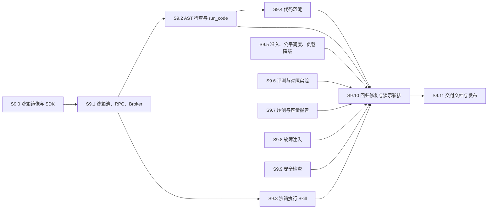

# P9 执行方案：沙箱、加固与发布

> 对应计划：`../phase-09-sandbox-hardening-release.md`
> 周期：D11～D15 ｜ 人员：BE-4（沙箱、降级）、BE-1（压测、故障注入、安全）、BE-2 / BE-3（评测与回归）、FE（联调）
> 集成分支：`phase/9-release`
> 进入条件：P5、P6、P7 冻结；P8 的后端部分完成

---

## 0. 执行顺序

| 检查点 | 应完成 |
|---|---|
| D11 傍晚 | S9.0 |
| D12 傍晚 | S9.1、S9.2、S9.5 |
| D13 傍晚 | S9.3、S9.4、S9.6、S9.7 |
| D14 傍晚 | S9.8、S9.9、S9.10（第一轮） |
| D15 中午 | S9.10（彩排） |
| D15 傍晚 | S9.11、演示 |

---

## S9.0 沙箱镜像与 SDK

**负责 / 时长**：BE-4 / 0.5 天　**前置**：P5

**产出**：`sandbox_image/{Dockerfile,drugpaper_sdk/}`

**执行**

1. 镜像：`python:3.12-slim` 基础上安装 `numpy`、`opencv-python-headless`、`scikit-image`、`pillow`、`pandas`、`scipy`、`rdkit`；非 root 用户 `sandbox`；工作目录 `/work`；入口 `python -m drugpaper_sdk.runner`。
2. `drugpaper_sdk`：
   - `runner`：从 stdin 读 JSON-RPC 请求（按行分帧），加载 `/input/main.py` 或 Skill 入口，调用 `main(ctx)`；
   - `ctx.image(name)`、`ctx.artifact(kind)`、`ctx.text_layer()`、`ctx.caption()`、`ctx.tools.call(name, args)`、`ctx.emit(result)`；
   - `tools.call` 通过 stdout 发送 RPC 请求，等待 stdin 上的结果；日志写 stderr。
3. SDK 速查文档按任务类型分节（图表、表格、分子框），作为 `sdk` 的 L3 资料，供 `read_skill_resource` 读取。

**完成标志**：本地 `docker run` 能执行一段示例代码并通过 RPC 调用一个模拟工具。

---

## S9.1 沙箱池、RPC、Broker

**负责 / 时长**：BE-4 / 0.75 天　**前置**：S9.0

**产出**：`drugpaper/sandbox/{pool.py,rpc.py,broker.py}`

**执行**

1. 预热池：`skill` 池与 `agent_code` 池各自维持 N 个空白容器（`docker run -d --network none --read-only --tmpfs /tmp --tmpfs /work --cap-drop ALL --security-opt no-new-privileges --pids-limit 128 --memory 512m --cpus 1 --user sandbox`，挂载只读 `/input`，可写 `/output` 上限 50 MB）。
2. 分配：`acquire(pool, user_id, document_id)` 检查配额（每用户 ≤ 4 个、每篇 `run_code` ≤ 5 次）；把输入文件拷入 `/input`；生成 `capability_token`（绑定 user、document、agent_run、白名单、预算，有效期等于执行超时）。
3. 执行：`docker exec -i` 启动 runner，建立 stdin/stdout 通道；超时（`run_code` 30 s）直接 kill。
4. 回收：无论成功失败都销毁容器，补充新的空白容器。
5. Broker：校验 RPC 中的令牌、工具名是否在白名单（不含任何模型调用）、预算；执行工具后返回结果。

**验证**：沙箱逃逸用例（安全检查清单中的沙箱部分）全部被阻止。

**完成标志**：测试通过；池在压力下能稳定补充容器。

---

## S9.2 AST 检查与 run_code

**负责 / 时长**：BE-4 / 0.5 天　**前置**：S9.1、P5 的 S5.9

**产出**：`drugpaper/sandbox/ast_guard.py`、`drugpaper/agents/figure/run_code.py`、`drugpaper/skills/builtin/remediation_actions/run_code/`

**执行**

1. `ast_guard.check(code)`：拒绝导入 `os`、`subprocess`、`socket`、`ctypes`、`multiprocessing`、`shutil`、`importlib`、`sys`（白名单以外的模块一律拒绝）；拒绝 `eval`、`exec`、`compile`、`__import__`、`open(..., 'w'/'a')`、对 `__builtins__`、`__class__`、`__subclasses__` 的访问；代码长度 ≤ 300 行。
2. `run_code` 动作：
   - 代码生成（任务 `agent_codegen`）：输入校验报告、目标 Skill 的输出 Schema、相关 SDK 速查；
   - AST 检查 → 沙箱执行 → 输出按 Schema 校验 → L1 全量校验；
   - 失败时带错误信息修正 1 次；
   - 代码、输入哈希、输出、日志写入 `code_executions`。
3. manifest 的 `triggers`：`C_AXIS_RESIDUAL`、`C_OVERLAY_IOU_LOW`、`C_HEADER_SPAN` 等内置动作无法处理的情况；`disclosure` 声明只在内置动作尝试过后才预选。
4. 负载降级 L1 及以上时禁用。

**验证**：构造一个双 y 轴图表（内置标定失败），`run_code` 生成代码后补救成功。

**完成标志**：至少 1 个真实长尾案例补救成功。

---

## S9.3 沙箱执行 Skill

**负责 / 时长**：BE-4 / 0.25 天　**前置**：S9.1

**执行**：SkillRuntime 中 `trust=sandboxed` 的 python 型 Skill 走沙箱执行（`skill` 池）；用户私有 Skill 强制沙箱；工具调用走 Broker。

**完成标志**：一个测试用第三方 Skill 在沙箱中执行成功。

---

## S9.4 代码沉淀

**负责 / 时长**：BE-4 / 0.5 天　**前置**：S9.2、P7 的 user 作用域

**产出**：`drugpaper/skills/sediment.py`、`drugpaper/api/skills.py`（沉淀相关接口）

**执行**

1. 统计：同一用户的 `code_executions` 按 `(image_type, failed_check_codes)` 聚类；同类成功 ≥ 3 次时生成沉淀建议。
2. 打包：选择最近一次成功的代码，生成 Skill 包：
   - `manifest.yaml`：`trust: sandboxed`、`scope: user`、`accepts`、`disclosure.triggers` 取自聚类键；
   - `SKILL.md` 的 L0 与 L1 草稿；
   - `tests/cases`：用触发过的真实输入生成。
   打包时扫描代码中的硬编码常量，列出供用户确认。
3. 确认：用户在 Skill 管理页查看代码、说明、测试结果，修改 L1 与 triggers 后确认，进入私有 Skill 库并激活；自动加入该用户 FigureAgent 的补救候选。

**完成标志**：沉淀流程端到端跑通，新 Skill 在同类失败时被预选。

---

## S9.5 准入、公平调度、负载降级

**负责 / 时长**：BE-4 / 0.5 天　**前置**：P7 的计量与限流

**产出**：`drugpaper/orchestration/{admission.py,fair_queue.py,degrade.py}`

**执行**

1. 准入：提交时检查全局队列深度（> 200 篇时进入等待）与用户并发配额（默认 20 篇）。
2. 公平调度：批量任务按用户分桶，调度器以加权轮询从各桶取任务投递 Celery；交互任务走独立高优先级队列。
3. 负载降级：每 30 s 计算各平台模型的排队等待 P95，按设计文档 7.7.8 的阈值切换 L0～L3；级别写入 Redis，FigureAgent、ReaderAgent、DocLookup 读取后调整行为；文档质量报告记录处理时的级别。
4. "补做复核"入口：对降级处理过的文档，按图派发 `review` 模式。

**验证**：人为限制模型并发并灌入任务，观察级别切换；交互请求的延迟不受影响。

**完成标志**：通过。

---

## S9.6 评测与对照实验

**负责 / 时长**：BE-2、BE-3 / 1 天　**前置**：P6 的评测脚手架

**产出**：`drugpaper/evals/{metrics.py,ab_c.py,report.py}`、`samples/outputs/phase-9/eval_report.md`

**执行**

1. 数据：银标准 10 篇以上（人工抽检后使用）；小金标准 10～15 篇（分子框与 SMILES、表格单元格、1～2 个图表数据点、lead / final / 主路线）。
2. 指标：设计文档 20.2 的各层指标。
3. 对照实验：A 现有流程；B 本系统 Corpus Markdown + 现有 `prompt_paper_v2.md`；C 本系统完整流程。
4. 报告：各层指标、A/B/C 对比、按模型来源分组的质量、调用数与耗时分布、失败案例清单。

**完成标志**：报告生成。

---

## S9.7 压测与容量报告

**负责 / 时长**：BE-1 / 0.75 天　**前置**：P7

**产出**：`ops/loadtest/`、`samples/outputs/phase-9/capacity_report.md`

**执行**：批量提交 100 篇；记录每阶段耗时、每篇各档位的调用数与槽·秒占用、排队等待、失败率；用实测数据代入设计文档 18.4 的公式，给出 1000、3000 篇/天所需的各档位并发槽。

**完成标志**：报告生成，失败率 < 10%。

---

## S9.8 故障注入

**负责 / 时长**：BE-1 / 0.5 天　**前置**：P5～P7

**产出**：`ops/chaos/`

**执行**

| 场景 | 期望 |
|---|---|
| 处理中杀掉 Worker | 任务重投，从 checkpoint 恢复，已完成步骤不重做 |
| 平台模型超时或返回 5xx | 重试 → 熔断 → 备用模型；恢复后自动回到主模型 |
| MinerU 不可用 | 文档停在 parsing，可重试，不影响其他文档 |
| 用户模型密钥失效 | 文档进入 `waiting_user_model`，修复后续跑 |
| 数据库短暂不可用 | 网关使用最后加载的注册表继续；写入失败的步骤重试 |
| Redis 重启 | 信号量租约过期后恢复，不永久占槽 |

**完成标志**：每个场景都能恢复，无数据丢失。

---

## S9.9 安全检查

**负责 / 时长**：BE-1 / 0.5 天　**前置**：P7、S9.1

**执行**：逐项执行阶段计划第 6 节的安全检查清单（SSRF、用户隔离、密钥、沙箱逃逸、提示注入、内部服务认证、管理接口），记录结果；发现的问题当场修复或列入修复计划。

**完成标志**：清单全部通过或有明确的修复计划与负责人。

---

## S9.10 回归修复与演示彩排

**负责 / 时长**：全员 / 1 天　**前置**：S9.2～S9.9

**执行**

1. 汇总 S9.6～S9.9 发现的问题，按严重程度分级：阻断演示的当天修复；其余进入迭代清单。
2. 全量回归：`make lint test test-int`、`verify_phase_1`～`verify_phase_8`、E2E。
3. 准备演示数据：10 篇批量论文、样例论文、一个带长尾图表的论文、一个用于自有 API 演示的推理端点。
4. 按阶段计划第 7 节的演示脚本彩排两次，记录每一步耗时。

**完成标志**：彩排无阻断问题。

---

## S9.11 交付文档与发布

**负责 / 时长**：BE-1 / 0.5 天　**前置**：S9.10

**产出**：`docs/deploy.md`、`docs/operations.md`、`docs/configuration.md`、`docs/interfaces/`（汇总）、`CHANGELOG.md`

**执行**

- 部署手册：依赖服务、环境变量、docker-compose 与各服务的启动顺序、首次初始化（迁移、导入模型注册表、创建管理员）。
- 运维手册：诊断命令（沿用现有 `diagnose_system.py` 的思路）、常见故障处理、降级级别说明、容量规划方法。
- 配置说明：`models.yaml`、`routing.yaml`、`metric_dictionary.yaml`、`services.yaml`、Skill 目录。
- 打标签 `v0.1.0`。

**完成标志**：新成员按部署手册能在一台干净机器上完成部署并跑通样例论文。
