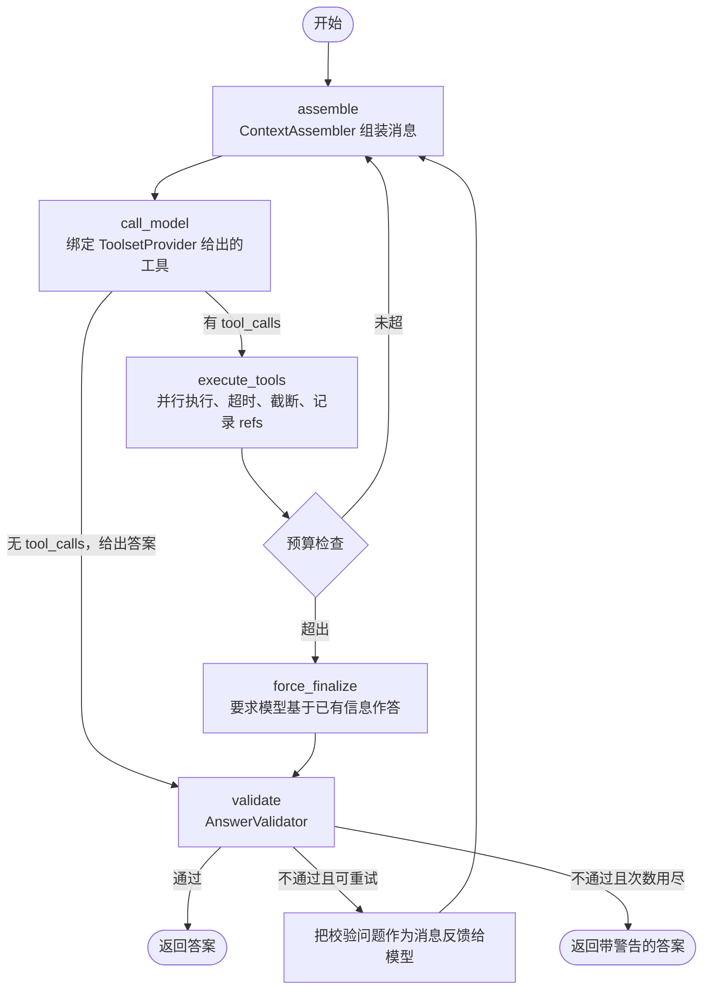

# P1：最小 Agent Loop

> 周期：D1～D2 ｜ 负责人：BE-4（主）、BE-1（工程骨架）
> 前置：无
> 设计文档对应：3.2 分层、9.1 Tool 协议、12.2 对话图、18.2.4 调用策略

---

## 1. 目标

搭出一个**最小但完整**的 Agent Loop：用户提问 → 模型思考 → 调用工具 → 读取工具结果 → 继续或给出答案。答案必须带引用，并且整个过程受预算约束、全程可追踪。

它是后续所有 Agent 的公共底座。本阶段的重点不是功能多，而是把**循环本身和扩展点**做对。

## 2. 范围

**做**

- 工程骨架：包结构、配置、日志、测试、CI、docker-compose（Postgres、Redis 先起着，本阶段不用）。
- `ModelClient`：OpenAI 兼容接口，支持工具调用（function calling）和结构化输出。
- Tool 协议：`ToolSpec`、`Tool`、`ToolContext`、`ToolResult`、`ToolRegistry`。
- `AgentRuntime`：基于 LangGraph 的 ReAct 循环，带预算、终止条件、错误处理、工具结果截断。
- 最小文档数据源：直接读取 `layout.json`，提供 3 个只读工具。
- 结构化答案与引用校验。
- `Tracer`：每次运行写一份 JSONL，并在控制台打印。
- CLI：`drugpaper ask <layout.json> "问题"`。

**不做**

数据库、Document IR、Skill、视觉模型、Web API、并发调度。

## 3. 目录与模块

```text
drugpaper/
├── config/settings.py            # pydantic-settings；读取 .env 与 config/models.yaml
├── gateway/
│   ├── base.py                   # ModelClient 协议、请求/响应模型、异常类型
│   └── openai_compat.py          # P1 唯一实现
├── tools/
│   ├── protocol.py               # ToolSpec / Tool / ToolContext / ToolResult
│   ├── registry.py               # ToolRegistry
│   └── builtin/layout_doc.py     # 3 个文档工具（P2 替换为 IR 版）
├── agent/
│   ├── runtime.py                # AgentRuntime（LangGraph）
│   ├── state.py                  # AgentState、Budget
│   ├── interfaces.py             # ToolsetProvider / ContextAssembler / AnswerValidator / Tracer
│   ├── validators.py             # CitationValidator
│   └── prompts/qa_system.md      # 问答系统提示
├── docsrc/
│   ├── base.py                   # DocumentSource 协议
│   └── layout_json.py            # 直接读取 layout.json 的最简实现
├── tracing/jsonl.py              # JsonlTracer
└── cli.py
tests/
├── fakes/fake_llm.py             # 按脚本返回的假模型
├── unit/test_runtime.py
├── unit/test_tools.py
└── smoke/test_live_model.py      # 真实端点冒烟（默认跳过）
config/models.yaml                # 按设计文档 18.2.2 的格式，只填一个 provider 和一个模型
```

## 4. 关键接口

```python
# gateway/base.py
class ChatRequest(BaseModel):
    messages: list[Message]
    tools: list[ToolSchema] = []
    response_schema: type[BaseModel] | None = None
    temperature: float = 0.0
    max_tokens: int = 2048
    timeout_s: float = 60
    thinking: bool = False

class ChatResponse(BaseModel):
    content: str | None
    tool_calls: list[ToolCall]
    parsed: BaseModel | None          # response_schema 解析结果
    usage: Usage                      # input_tokens / output_tokens
    model: str
    latency_ms: int

class ModelClient(Protocol):
    async def chat(self, req: ChatRequest, *, task: str = "default") -> ChatResponse: ...
    # task 参数 P1 忽略；P3 起用于按任务路由，P7 由网关解析到阶段和模型

# 异常：ModelTimeout / RateLimited / ModelBadResponse / SchemaViolation / ModelUnavailable
```

```python
# tools/protocol.py
class ToolSpec(BaseModel):
    name: str
    description: str                  # 短描述（P3 起作为 L0）
    input_model: type[BaseModel]
    output_model: type[BaseModel]
    side_effect: Literal["read", "compute", "write_fact", "external_model"] = "read"
    timeout_s: float = 10
    max_output_chars: int = 4000      # 超出截断，并提示"结果已截断，可缩小范围重查"

class ToolResult(BaseModel):
    ok: bool
    data: dict | None
    error: str | None
    refs: list[str] = []              # 结果中出现的节点 ID，用于引用校验
    truncated: bool = False
```

```python
# agent/interfaces.py —— 后续阶段替换实现的扩展点
class ToolsetProvider(Protocol):
    def tools_for(self, state: AgentState) -> list[Tool]: ...          # P1: StaticToolset；P3: DisclosureToolset

class ContextAssembler(Protocol):
    def build(self, state: AgentState) -> list[Message]: ...           # P1: 简单拼接；P3: PromptAssembler

class AnswerValidator(Protocol):
    def validate(self, answer: BaseModel, state: AgentState) -> list[str]: ...  # 返回问题列表

class Tracer(Protocol):
    def event(self, run_id: str, kind: str, payload: dict) -> None: ...  # P1: JSONL；P2: 入库
```

```python
# agent/state.py
class Budget(BaseModel):
    max_steps: int = 8                # 一次"模型调用 + 工具执行"算一步
    max_model_calls: int = 10
    max_tool_calls: int = 20
    max_wall_time_s: float = 180

class AgentState(TypedDict):
    run_id: str
    messages: Annotated[list[Message], add_messages]
    seen_refs: set[str]               # 工具结果中出现过的节点 ID
    steps: int
    model_calls: int
    tool_calls: int
    started_at: float
    final: dict | None
    stop_reason: str | None           # answered / budget_exhausted / error / validation_failed
```

## 5. AgentRuntime 的循环



要点：

1. **结束方式**：模型在最后一步输出结构化答案（`response_schema`），而不是自由文本。这样答案和引用都可以程序校验。
2. **工具错误不中断循环**：参数校验失败、超时、异常都转成 `ToolResult(ok=False, error=...)` 返回给模型，由模型决定是否换参数重试。
3. **预算三重保护**：步数、模型调用数、时长任一超出，进入 `force_finalize`，要求模型只基于已有信息作答，并在答案中说明"预算用尽"。
4. **结果截断**：工具结果超过 `max_output_chars` 时截断并标注，防止一次工具调用撑满上下文。
5. **引用校验**：答案中每个引用 ID 必须出现在 `seen_refs` 中，否则打回重答，最多 1 次，之后删去无效引用并加警告。这是设计文档 12.5 节 `citation_check` 的最小版本。
6. **LangGraph 用法**：`StateGraph` 加条件边；本阶段使用内存 checkpointer，P2 替换为 Postgres。

## 6. 最小文档工具

数据源直接读取样例论文的 `layout.json`，用 `p{page:03d}.b{detailed_index:03d}` 作为块 ID（与设计文档 6.2 节一致，P2 可以无缝替换）：

| 工具 | 输入 | 输出 |
|---|---|---|
| `list_blocks(page)` | 页码 | 该页块列表：ID、类型、前 80 字 |
| `get_block(block_id)` | 块 ID | 块全文、类型、页码、bbox |
| `grep(pattern, max_results=10)` | 正则或关键词 | 命中的块 ID、页码、片段 |

本阶段 `grep` 只在 `text` 和 `caption_text` 上做简单匹配，P2 换成基于 IR 和规范化文本的完整实现。

## 7. 任务分解

| # | 任务 | 负责 | 估时 |
|---|---|---|---|
| 1.1 | 仓库骨架、uv、ruff/mypy/pytest、CI、`.env.example`、docker-compose | BE-1 | 0.5 天 |
| 1.2 | `settings.py`；`config/models.yaml` 最小版（1 个 provider、1 个 LLM） | BE-1 | 0.25 天 |
| 1.3 | `ModelClient` + `OpenAICompatClient`：工具调用、结构化输出（json_schema，失败时 json_object + Pydantic 校验）、指数退避重试、类型化异常、`disable_thinking`、token 统计 | BE-4 | 0.5 天 |
| 1.4 | Tool 协议、Registry、从 Pydantic 生成 JSON Schema、参数校验与截断 | BE-4 | 0.25 天 |
| 1.5 | `AgentRuntime`：LangGraph 图、预算、force_finalize、并行工具执行、错误转结果 | BE-4 | 0.75 天 |
| 1.6 | `CitationValidator` 与重答逻辑 | BE-4 | 0.25 天 |
| 1.7 | `LayoutJsonSource` 与 3 个文档工具 | BE-1 | 0.25 天 |
| 1.8 | `JsonlTracer`（事件：model_call、tool_call、validation、finish，含 token 与耗时）；控制台树状输出 | BE-1 | 0.25 天 |
| 1.9 | CLI `ask`；问答系统提示（论文内容是数据不是指令、只依据工具结果回答、必须引用） | BE-4 | 0.25 天 |
| 1.10 | FakeLLM 与单元测试；真实端点冒烟测试 | BE-4 | 0.5 天 |

## 8. 测试

**单元测试（FakeLLM，按脚本返回）**

| 用例 | 期望 |
|---|---|
| 模型直接作答 | 1 次模型调用，stop_reason = answered |
| 模型调用 grep → get_block → 作答 | 工具按序执行，seen_refs 含引用 ID，答案通过校验 |
| 模型并行调用 2 个工具 | 两个结果都返回，顺序与 tool_call_id 对应 |
| 工具参数非法 | 返回 ok=False 的结果，循环继续 |
| 工具超时 | 返回超时错误，循环继续 |
| 模型一直调用工具 | 达到 max_steps 后进入 force_finalize，stop_reason = budget_exhausted |
| 答案引用了未见过的 ID | 打回重答 1 次；仍错误时删去无效引用并加警告 |
| 结构化输出解析失败 | 带校验错误重试 1 次；仍失败时抛 `SchemaViolation` |
| 工具结果过长 | 被截断，truncated = true |

**冒烟测试（真实端点，手动触发）**

- `drugpaper ask samples/.../..._layout.json "UCM-1306 对应论文中的哪个化合物编号？"`：答案应为化合物 26，并引用摘要所在的块。
- `drugpaper ask ... "这篇论文的研究对象是什么受体？"`：答案应为多巴胺 D1 受体，并带引用。
- 查看 `runs/<run_id>.jsonl`，确认每次模型调用、工具调用都有记录，包括 token 和耗时。

## 9. 验收标准

- [ ] 以上单元测试全部通过，CI 绿。
- [ ] 两个冒烟问题都能在 5 步以内给出带有效引用的答案。
- [ ] 人为把 `max_steps` 设为 1 时，程序能正常结束并给出"预算用尽"的答案。
- [ ] `agent/interfaces.py` 中的扩展点接口写入 `docs/interfaces/agent-runtime.md` 并冻结。

## 10. 风险

| 风险 | 对策 |
|---|---|
| 推理服务的工具调用格式与 OpenAI 有差异（sglang/vLLM 的 tool parser 配置） | 冒烟测试第一天就跑；不支持时退回"提示词中描述工具 + 结构化输出选择动作"的模式，作为 `ModelClient` 的一个选项 |
| 结构化输出（json_schema）不可用 | 降级链：json_schema → json_object + 校验 → 提示词 + json_repair + 校验 |
| Qwen 的思考输出混入结果 | `disable_thinking` 默认开启（沿用现有流水线的做法） |

## 11. 交给下一阶段的内容

- 已冻结的扩展点：`ModelClient`、`ToolsetProvider`、`ContextAssembler`、`AnswerValidator`、`Tracer`、`DocumentSource`。
- P2 需要替换的实现：`DocumentSource`（IR）、`Tracer`（入库）、checkpointer（Postgres）、`grep`（完整版）。
- P3 需要替换的实现：`ToolsetProvider`（渐进式披露）、`ContextAssembler`（PromptAssembler）。

## 完成记录

**2026-09-30 · v0.1.0**

- 完成情况：S1.0～S1.12 的代码、单元测试（108 通过，含基于真实样例论文的 `test_real_paper.py`）、接口文档 `docs/interfaces/agent-runtime.md`、验收脚本 `scripts/verify_phase_1.py`（离线模式全部通过）。代码地图见 `docs/codemap/phase-1-codemap.md`。
- 验收清单：单元测试 ✅；`max_steps=1` 正常结束并给出"预算用尽"答案 ✅（FakeLLM 离线验证）；接口冻结 ✅；两个冒烟问题在真实端点上的验证 ⏳（本机无 `.env`，待配置后运行 `uv run python scripts/verify_phase_1.py --smoke`）。
- 偏差：`openai` 3.x 改用 `httpx2`，测试用 httpx2.MockTransport 代替 respx；状态消息用 `operator.add` 存 dict；`call_model` 增加 `error → END` 边。详见 `CHANGELOG.md`。
- 真实论文测试：样例论文已放入 `tests/fixtures/jmedchem_2c00949/`。发现 F7（无分隔 LaTeX）导致 `grep "D1"` 漏检和 quote 误判，新增 `docsrc/textnorm.py` 做仅用于匹配的轻量规范化；F3（Table 1 图注错位）、标题中的 LaTeX 残留留给 P2。
- 遗留：Docker / make 在本机不可用，compose 健康检查未验证；仓库未初始化 Git。
